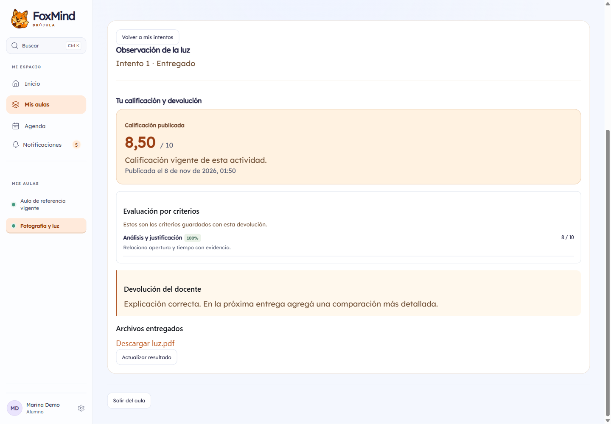

# FoxMind

Una plataforma para organizar aulas, contenidos, actividades, entregas y devoluciones. Cada cuenta tiene un rol exclusivo de docente o estudiante; propiedad y membresía definen qué puede hacer en cada aula.

## Entender y usar el proyecto

- [Documentación vigente](docs/README.md): entrada única de la base actual.
- [Arquitectura y tecnologías](docs/engineering/architecture.md), [modelo de datos](docs/engineering/data-model.md) y [funciones por rol](docs/product/features-by-role.md).
- [UX/UI y referencias reales](docs/design/README.md), [capturas](docs/design/current/README.md) y [checks por flujo/rol](docs/verification/flows.md).
- [Ejecutar en local](docs/engineering/local-development/README.md) y [verificar](docs/engineering/testing/README.md).
- [Cómo documentar cambios](docs/documentation-policy.md) y [plantilla de funcionalidad](docs/templates/feature.md).

| Interfaz | Backend | Datos y servicios |
|---|---|---|
| Next.js, React, TypeScript y Brújula | NestJS y capacidades modulares | PostgreSQL/Prisma, archivos privados compatibles con S3, ClamAV y Mailpit |

Las imágenes provienen de la aplicación real con cuentas y datos sintéticos sobre recursos locales descartables. La IA del ensayo usa proveedores sintéticos. [Alcance y límites](docs/verification/flows.md). No se afirma despliegue ni piloto real.

La documentación anterior se retiró por decisión del usuario; el historial Git no se reescribe. La fuente de trabajo futura es esta base vigente. [Estado](docs/implementation-roadmap.md) · [Instrucciones de colaboración](AGENTS.md).
