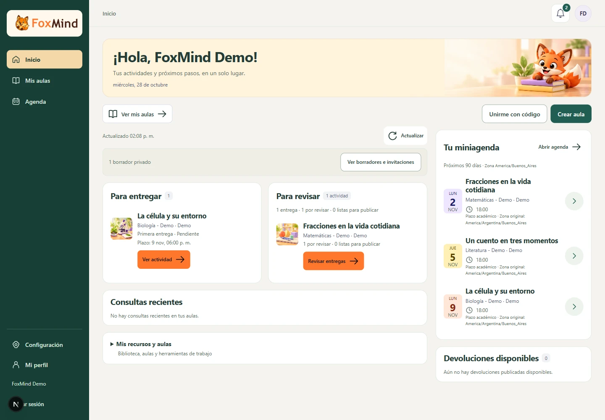
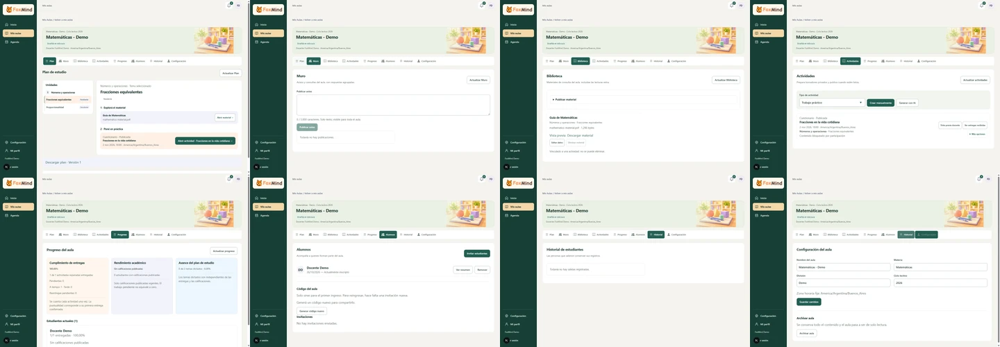
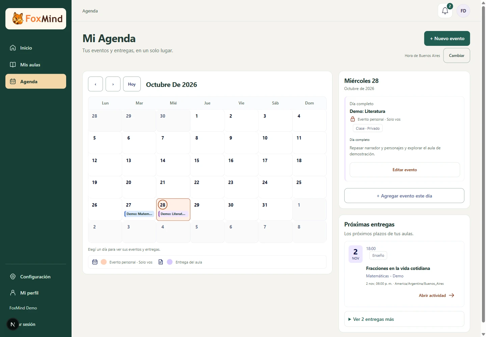

  

  **Un espacio para enseñar, aprender y avanzar juntos.**

  Aulas, actividades y organización en una plataforma educativa para docentes y estudiantes.

  [Conocé FoxMind](#conocé-foxmind) · [Empezar en local](#empezar-en-local) · [Documentación](#documentación)

 

## Conocé FoxMind

FoxMind reúne la experiencia de una clase en un mismo lugar. Los docentes pueden organizar contenidos y actividades, y los estudiantes encuentran sus aulas, entregas y devoluciones en una interfaz clara y cercana. Una misma cuenta puede enseñar en un aula y aprender en otra.

| Para organizar | Para aprender y enseñar |
| --- | --- |
| **Aulas** · Creá o integrá espacios para cada materia. | **Actividades** · Prepará trabajos y cuestionarios, y seguí sus entregas. |
| **Plan y biblioteca** · Ordená unidades, temas y recursos. | **Devoluciones** · Revisá trabajos, publicá calificaciones y consultá el progreso. |
| **Agenda** · Consultá eventos y próximas entregas. | **Muro** · Compartí novedades dentro del aula. |

## Un vistazo a la plataforma

<table>
  <tr>
    <td width="50%"><strong>Dentro del aula</strong> Accedé a los espacios y herramientas de una materia.</td>
    <td width="50%"><strong>Agenda</strong> Visualizá tus eventos y organizá tus próximos días.</td>
  </tr>
  <tr>
    <td></td>
    <td></td>
  </tr>
</table>

Capturas de la aplicación local con una cuenta demo y datos sintéticos, tomadas el 28 de octubre de 2026. La interfaz continúa evolucionando.

## Tecnologías

| Interfaz | Servidor | Datos y servicios locales |
| --- | --- | --- |
| Next.js · React · TypeScript | NestJS · TypeScript | PostgreSQL · almacenamiento privado compatible con S3 · ClamAV · Mailpit |

## Empezar en local

Necesitás **Node.js 24** y las dependencias correspondientes al archivo de bloqueo. La aplicación completa también requiere PostgreSQL, almacenamiento privado compatible con S3, ClamAV, Mailpit y la configuración de identidad y aulas. La base de datos debe estar preparada por separado antes de iniciar los servicios.

1. Consultá la [entrada de desarrollo local](docs/engineering/local-development/README.md) y la [guía de operación](docs/engineering/local-development/operation.md) para preparar los servicios y la configuración.
2. Instalá las dependencias del proyecto con `npm ci`.
3. Una vez preparado el entorno, compilá y ejecutá la API y la web según las instrucciones de la guía.

La guía detalla las variables, los orígenes y los límites de cada servicio. Mailpit captura correo localmente; no envía mensajes reales a destinatarios externos.

## Documentación

- [Índice de documentación](docs/README.md) · Guías, contratos y evidencia.
- [Roadmap](docs/implementation-roadmap.md#estado-actual) · Estado verificado y próximos pasos.
- [Arquitectura](docs/engineering/architecture.md) · Responsabilidades y flujo del sistema.
- [Especificación funcional](docs/foxmind-v1-functional-spec.md) · Alcance y reglas del producto.
- [Operación local](docs/engineering/local-development/README.md) · Preparación, ejecución y recuperación.
- [Instrucciones para agentes y colaboradores](AGENTS.md) · Continuidad del trabajo y registros.

## Estado del proyecto

FoxMind cuenta con una V1 validada localmente y continúa evolucionando. Las verificaciones, sus límites y los próximos trabajos están registrados en el [roadmap](docs/implementation-roadmap.md). El repositorio no representa por sí solo un servicio desplegado ni un piloto con participantes reales.
