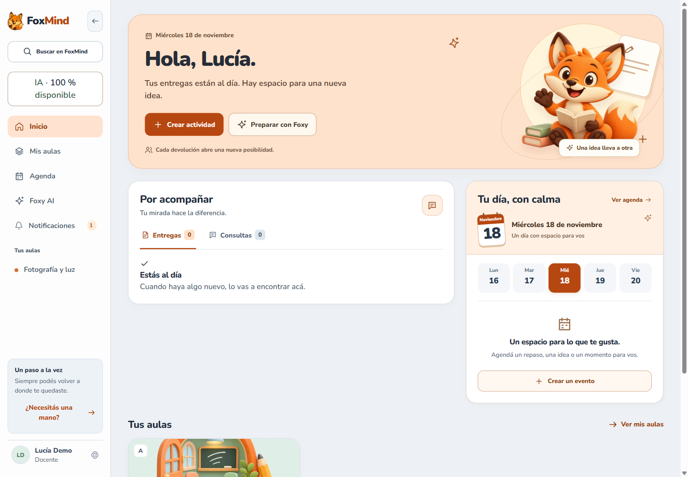
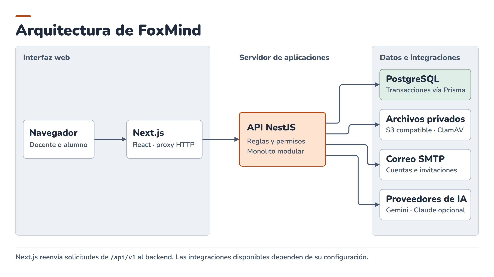

# FoxMind

FoxMind reúne el aula del docente y el espacio personal de estudio del estudiante. En **Mis aulas**, el docente organiza el programa, comparte materiales y acompaña cada entrega hasta publicar la devolución. En **Mi Estudio**, el estudiante puede tomar ese programa como punto de partida, sumar sus propias fuentes, practicar con Foxy y llevar un repaso a Agenda.



## Del aula a la práctica

| | Docente | Estudiante |
|---|---|---|
| Aula compartida | Prepara unidades y temas, publica recursos en Biblioteca, responde consultas en el Muro y asigna trabajos prácticos, cuestionarios y evaluaciones. | Ingresa por código o invitación, consulta el plan, abre materiales, responde actividades y confirma sus entregas. |
| Seguimiento | Revisa intentos, guarda correcciones privadas y publica la devolución. Consulta cumplimiento, rendimiento y avance del plan. | Ve sus intentos, notas publicadas y reentregas habilitadas. |
| Trabajo privado con IA | En Foxy prepara planes de clase, actividades, rúbricas, apuntes y recursos visuales. Revisa qué comparte con el aula. | En una carpeta reúne fuentes, pide pistas sobre su intento, crea esquemas e imágenes, practica y confirma repasos en Agenda. |

El arnés pedagógico guía las respuestas y propuestas de Foxy en esos recorridos. El backend controla el contexto autorizado y la cuota mensual por cuenta. La evaluación de aprendizaje y tiempo docente con participantes está preparada para coordinar. [Funciones por sección](docs/product/features-by-role.md) · [IA](docs/engineering/ai/README.md) · [Estado y evidencia](docs/implementation-roadmap.md)

## Cómo está distribuido el proyecto

Una web Next.js usa la API modular NestJS. La API comprueba quién puede operar sobre cada recurso y conserva el estado académico en PostgreSQL. Los archivos tienen custodia privada y escaneo. Las integraciones de IA se configuran del lado del servidor. [Arquitectura y tecnologías](docs/engineering/architecture.md) · [Diagrama del sistema](docs/diagramas/arquitectura.html) · [Flujo de una actividad](docs/diagramas/actividad.html) · [Fuentes y repaso privado](docs/diagramas/estudio.html)

[](docs/diagramas/arquitectura.html)

| Si necesitás encontrar… | Empezá por |
|---|---|
| Una página, navegación o flujo de interfaz | [Rutas y proxies Next](apps/web/pages), [pantallas](apps/web/src/screens), [funciones de producto](apps/web/src/features) y [composición](apps/web/src/application). |
| Estilos y componentes | [Controles compartidos](apps/shared-ui), [estilos del entorno autenticado](apps/web/src/application/shell/styles) y [guía de diseño Brújula](docs/design/README.md). |
| Una regla o un endpoint del backend | [Módulos por dominio](apps/api/src/modules), [composición de la API](apps/api/src/bootstrap) y [servicios técnicos compartidos](apps/api/src/platform). |
| Reglas independientes del framework y tipos compartidos | [Dominio](src/core/domain) y [contratos](src/core/contracts). |
| Tablas, relaciones y evolución de la base | [Esquema Prisma](prisma/schema.prisma), [migraciones SQL](prisma/migrations) y [modelo de datos](docs/engineering/data-model.md). |
| Pruebas y comandos | [Tests de sistema y contratos](tests), pruebas junto a cada módulo, [scripts](scripts) y [workflows de CI](.github/workflows). |
| Especificaciones, decisiones y evidencia | [Índice de documentación](docs/README.md), [tableros por funcionalidad](odd/tasks) y [verificaciones fechadas](docs/verification/README.md). |

## Ejecutar en local

Necesitás **Node.js 24**, npm y Docker Desktop con el motor Linux. Desde la raíz, instalá las dependencias con `npm ci`. Para el arranque habitual, el archivo `.env` de la raíz debe tener `AI_ENABLED=true` y una `AI_API_KEY` de Gemini autorizada. El supervisor prepara los servicios propios y aplica sus migraciones.

```sh
npm run local:up
npm run local:status
npm run local:stop
```

La web escucha en `http://127.0.0.1:3000` y la API en el puerto `3001`. El arranque habitual usa Gemini cuando está configurado y la detención conserva los datos locales. Para recorrer la web con identidades de prueba y proveedores sintéticos, la guía incluye un entorno descartable. [Preparación, configuración y arranque](docs/engineering/local-development/README.md)

## Verificar un cambio

| Objetivo | Comando desde la raíz |
|---|---|
| Enlaces y contratos documentales | `npm run docs:check` |
| Compilar API o web | `npm run api:build` · `npm run web:build` |
| Verificar dependencias entre módulos | `npm run lint:boundaries` |
| Ejecutar pruebas rápidas del proyecto | `npm run test:complete -- --group fast` |

Para pruebas de base de datos, navegador o proveedores, consultá los requisitos de cada suite. [Guía de pruebas](docs/engineering/testing/README.md) · [Galería de la aplicación](docs/design/current/README.md)
