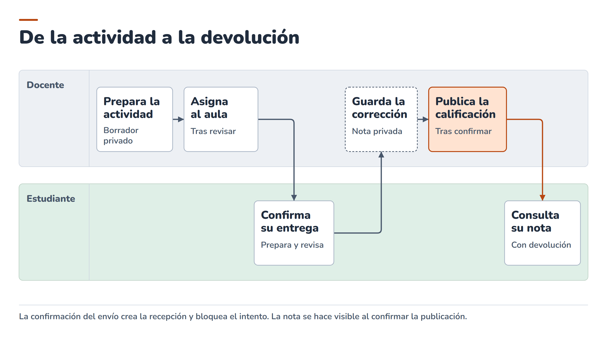

# Documentación de FoxMind

Para conocer el producto, empezá por los [recorridos y la distribución del repositorio](../README.md). El [estado de la aplicación](implementation-roadmap.md) reúne lo integrado en `main`, la evidencia disponible y las decisiones abiertas al 18 de noviembre de 2026.

| Si querés… | Leé |
|---|---|
| Entender qué ve y qué puede hacer cada persona | [Funciones por rol y sección](product/features-by-role.md) y [reglas del producto](foxmind-v1-functional-spec.md). |
| Seguir una actividad desde el borrador hasta la nota publicada | [Diagrama del recorrido](diagramas/actividad.html), [autoría](engineering/activities/authoring.md) y [participación](engineering/activities/participation.md). |
| Diseñar una pantalla coherente con la app | [Guía de diseño Brújula](design/README.md) y [capturas de escritorio y móvil](design/current/README.md). |
| Ubicar un componente y sus dependencias | [Diagrama de arquitectura](diagramas/arquitectura.html), [guía técnica](engineering/architecture.md), [dominios](engineering/README.md) y [modelo de datos](engineering/data-model.md). |
| Entender la IA y el arnés pedagógico | [IA y presupuesto por cuenta](engineering/ai/README.md), [Foxy docente](engineering/ai/foxy.md), [flujo de estudio privado](diagramas/estudio.html), [Mi Estudio](engineering/study/README.md) y [aceptación del arnés](../odd/tasks/pedagogical-harness.md). |
| Integrar cuentas o archivos | [Contrato de identidad](api/accounts-sessions.md), [OpenAPI](api/accounts-sessions.openapi.json) y [contrato de archivos](api/files.md). |
| Ejecutar y verificar la aplicación | [Desarrollo local](engineering/local-development/README.md), [pruebas](engineering/testing/README.md) y [evidencia por recorrido](verification/README.md). |
| Actualizar esta documentación | [Política documental](documentation-policy.md), [plantilla de funcionalidad](templates/feature.md) y [registro de trabajo](work-log/README.md). |

Los diagramas son archivos HTML autónomos. Abrilos desde una copia local del repositorio para recorrerlos a tamaño completo. Los recibos y registros fechados identifican qué se ensayó en cada versión.
