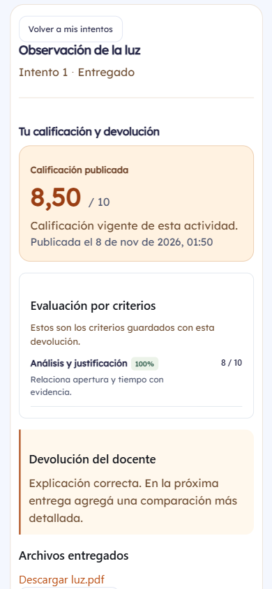

# Capturas del FoxMind actual

## Inicio docente — 2026-11-11

Estas referencias sustituyen la presentación anterior de los cuatro widgets del inicio docente. Capturas Ego Lite sobre componentes/CSS reales con cliente sintético, sin proveedor ni cuentas reales. Inspeccionadas individualmente; hashes y límites en el [recibo](../../verification/teacher-home-polish.json).

| Vista | Referencia |
|---|---|
| Escritorio 1440×1000, página completa | [Inicio docente](../../verification/teacher-home-polish/desktop-final.png) |
| Diálogo de acción, escritorio | [Elegir aula](../../verification/teacher-home-polish/action-dialog.png) |
| Móvil 390×844, página completa | [Inicio móvil](../../verification/teacher-home-polish/mobile-final.png) |
| Diálogo de acción, móvil | [Elegir aula móvil](../../verification/teacher-home-polish/mobile-dialog.png) |
| Tablet 768×1024, página completa | [Inicio tablet](../../verification/teacher-home-polish/tablet-final.png) |

El harness verifica destinos emitidos y estados de interfaz; no atribuir a esas capturas una escritura académica o un login integrado. Inicio estudiante y demás superficies conservan sus referencias.

Pulido de Foxy, Carpetas y creación, 2026-11-09: capturas nativas Ego Lite recuperadas e inspeccionadas en escritorio 1440×1000 y móvil 390×844. Sustituyen la presentación anterior de esas superficies. App local integrada con cuentas y contenido sintéticos para colecciones/chats/creación; esperas, errores y propuesta de plan usan los componentes reales en un harness con respuestas explícitamente sintéticas. Cada metadato identifica su alcance; no atribuir persistencia o proveedor real al harness. Ver [diseño vigente](../README.md), [recibo](../../verification/foxy-study-ux-polish.json) y [registro visual](../../work-log/2026-11-09-root-ux-visual.md).

## Referencias vigentes del pulido — 2026-11-09

Escritorio: 1440×1000. Móvil: 390×844. Las 28 imágenes de esta tabla fueron inspeccionadas individualmente. Los [metadatos y hashes](catalog.json) identifican rol, ruta, desplazamiento y procedencia; no se infiere una llamada real a IA desde una espera sintética.

| Flujo o estado | Escritorio | Móvil | Alcance de la captura |
|---|---|---|---|
| Foxy AI | [Ver escritorio](ux-foxy-desktop.png) | [Ver móvil](ux-foxy-mobile.png) | App integrada |
| Herramientas docentes | — | [Ver móvil](ux-foxy-tools-mobile.png) | App integrada |
| Chat docente en espera | [Ver escritorio](ux-foxy-pending-desktop.png) | [Ver móvil](ux-foxy-pending-mobile.png) | Componentes reales; respuesta sintética |
| Carpetas de estudio | [Ver escritorio](ux-study-collection-desktop.png) | [Ver móvil](ux-study-collection-mobile.png) | App integrada |
| Chat estudiantil | [Ver escritorio](ux-study-chat-desktop.png) | [Ver móvil](ux-study-chat-mobile.png) | App integrada; conversación de prueba existente |
| Herramientas estudiantiles | — | [Ver móvil](ux-study-tools-mobile.png) | App integrada |
| Chat estudiantil en espera | [Ver escritorio](ux-study-pending-desktop.png) | [Ver móvil](ux-study-pending-mobile.png) | Componentes reales; respuesta sintética |
| Error y entrada conservada | [Ver escritorio](ux-study-error-desktop.png) | [Ver móvil](ux-study-error-mobile.png) | Componentes reales; fallo sintético |
| Mis aulas | [Ver escritorio](ux-classrooms-desktop.png) | [Ver móvil](ux-classrooms-mobile.png) | App integrada |
| Crear aula | [Ver escritorio](ux-classroom-create-desktop.png) | [Ver móvil](ux-classroom-create-mobile.png) | App integrada; borrador propio de QA sin publicar |
| Crear carpeta | [Ver escritorio](ux-study-create-desktop.png) | [Ver móvil](ux-study-create-mobile.png) | App integrada; creación sin guardar |
| Portadas de carpeta | [Ver escritorio](ux-study-covers-desktop.png) | [Ver móvil](ux-study-covers-mobile.png) | App integrada; diálogo desplazado |
| Portadas de aula | — | [Ver móvil](ux-classroom-covers-mobile.png) | App integrada; diálogo desplazado |
| Plan en análisis | [Ver escritorio](ux-plan-loading-desktop.png) | [Ver móvil](ux-plan-loading-mobile.png) | Componentes reales; generación sintética |
| Revisión del plan | [Ver escritorio](ux-plan-review-desktop.png) | [Ver móvil](ux-plan-review-mobile.png) | Componentes reales; propuesta sintética |
| Edición de unidad | — | [Ver móvil](ux-plan-editor-mobile.png) | Componentes reales; unidad abierta |

## Referencias conservadas de otras superficies y recorridos previos

Las referencias siguientes conservan evidencia de su fecha. Para Foxy, colecciones de Aulas/Carpetas y creación/plan, usar la tabla vigente anterior. Prácticas, examen, perfil y otras pantallas sin rediseño mantienen sus referencias específicas.

Ego Lite, 2026-11-07; cuentas y datos sintéticos en servicios locales descartables. Este lote documenta la base inspeccionada entonces. Cada PNG tiene metadatos de ruta, viewport, ancho de documento, títulos y alertas; [catálogo con hashes](catalog.json). Las credenciales y enlaces privados de confirmación no se guardan en las imágenes ni sus metadatos.

Las capturas son referencias visuales; la [matriz de recorridos](../../verification/flows.md) explica acciones, resultados y límites. No todas muestran un éxito: review es validación faltante, diagram-state es cuota, student-ai es indisponibilidad; los nombres heredados del paso de captura no sustituyen esa descripción. El lote base no tuvo inspección visual individual de todas sus imágenes ni auditoría WCAG completa; esto no describe las 28 referencias nuevas, que sí se inspeccionaron.

Actualización de Perfil y Configuración del 2026-11-08: avatares Foxy para ambos roles con vista previa/guardado explícito. Referencias vigentes: [perfil docente](teacher-profile-avatars.png), [tablet](teacher-profile-avatars-tablet.png), [móvil](teacher-profile-avatars-mobile.png), [perfil estudiante](student-profile-avatars.png), [móvil estudiante](student-profile-avatars-mobile.png), [configuración docente](teacher-account-settings.png) y [móvil](teacher-account-settings-mobile.png), [configuración estudiante](student-account-settings.png) y [móvil](student-account-settings-mobile.png). Sustituyen la presentación anterior de esas pantallas; las referencias anteriores sólo conservan evidencia de los recorridos documentados entonces. API/PostgreSQL reales propios y cuentas sintéticas, sin generación IA de producto. [Recibo](../../verification/profile-avatars.json) y [límites](../../work-log/2026-11-08-root-profile-avatars.md).

### Recorridos y capturas conservados

Carpetas de estudio, evidencia del 2026-11-08 (colección/workspace sustituidos visualmente por las referencias del 2026-11-09): [colección](student-study-folders.png), [colección móvil](student-study-folders-mobile.png), [workspace](student-study-workspace.png), [tablet](student-study-workspace-tablet.png), [móvil](student-study-workspace-mobile.png), [práctica](student-study-practice.png), [práctica tablet](student-study-practice-tablet.png), [práctica móvil](student-study-practice-mobile.png), [examen](student-study-exam.png) y [aviso privado](student-study-reminder.png). Colección/chat/examen/aviso: app habitual propia, cuenta/materiales sintéticos y chat Gemini; cronograma determinista. Prácticas: app/servicios aislados reales con proveedor explícitamente sintético. Metadatos por captura y hashes exactos en catálogo; sin overflow a390/834/1440. [Recibo y límites](../../verification/study-folders.json).

Foxy, referencia del 2026-11-08 sustituida por el pulido del 2026-11-09: [escritorio](teacher-foxy-discovery-desktop.png), [tablet](teacher-foxy-discovery-tablet.png) y [móvil](teacher-foxy-discovery-mobile.png). Documentan la incorporación de conversaciones con búsqueda/renombrado y widget Herramientas/Creaciones en esa fecha; la presentación vigente está en la tabla anterior. Usan aplicación/API/PostgreSQL/archivos reales en recursos propios y proveedor IA sintético. Los flujos de publicación anteriores conservan sus reglas; sus capturas no representan la nueva organización del workspace. [Recibo de navegación/foco](../../verification/foxy-discovery.json), [evidencia y límites](../../work-log/2026-11-08-root-foxy-implementation.md).

Mis aulas, evidencia de Pendientes del 2026-11-08 (presentación de colección sustituida el 2026-11-09): [Pendientes escritorio](teacher-pending-desktop.png), [móvil](teacher-pending-mobile.png) y [tablet](teacher-pending-tablet.png). Estas tres referencias usan componentes reales con cliente sintético en memoria; documentan los borradores del catálogo en esa fecha. Las capturas de la base del 2026-11-07 no acreditan este flujo nuevo. Permisos y persistencia se comprobaron por separado sobre PostgreSQL descartable, según el [registro](../../work-log/2026-11-08-root-pending-classrooms.md).

| Captura | Ruta | Viewport | Desborde horizontal registrado |
|---|---|---|---|
| [auth-login](auth-login.png) | `/sign-in` | 1440 × 1000 | No |
| [auth-recovered](auth-recovered.png) | `/recover-password` | 1440 × 1000 | No |
| [auth-recovery-confirm](auth-recovery-confirm.png) | `/recover-password` | 1440 × 1000 | No |
| [auth-recovery-requested](auth-recovery-requested.png) | `/forgot-password` | 1440 × 1000 | No |
| [auth-recovery](auth-recovery.png) | `/forgot-password` | 1440 × 1000 | No |
| [auth-register-mobile](auth-register-mobile.png) | `/register` | 390 × 844 | No |
| [auth-register](auth-register.png) | `/register` | 1440 × 1000 | No |
| [auth-registration-result](auth-registration-result.png) | `/register` | 1440 × 1000 | No |
| [auth-student-registered](auth-student-registered.png) | `/register` | 1440 × 1000 | No |
| [auth-verification-pending](auth-verification-pending.png) | `/verify-email` | 1440 × 1000 | No |
| [auth-verified](auth-verified.png) | `/verify-email` | 1440 × 1000 | No |
| [student-account-settings](student-account-settings.png) | `/settings` | 1440 × 1000 | No |
| [student-activities](student-activities.png) | `/mis-aulas?aula=110f4036-92c1-4c41-862d-7a19e3cfc77c` | 1440 × 1000 | No |
| [student-agenda-private](student-agenda-private.png) | `/agenda` | 1440 × 1000 | No |
| [student-archived-readonly](student-archived-readonly.png) | `/mis-aulas?aula=e78f1c34-7fdb-4de6-84ad-95da058cf626` | 1440 × 1000 | No |
| [student-assignment](student-assignment.png) | `/mis-aulas?aula=110f4036-92c1-4c41-862d-7a19e3cfc77c` | 1440 × 1000 | No |
| [student-attempt-editor](student-attempt-editor.png) | `/mis-aulas?aula=110f4036-92c1-4c41-862d-7a19e3cfc77c` | 1440 × 1000 | No |
| [student-before-grade-publication](student-before-grade-publication.png) | `/inicio` | 1440 × 1000 | No |
| [student-classmates](student-classmates.png) | `/mis-aulas?aula=110f4036-92c1-4c41-862d-7a19e3cfc77c` | 1440 × 1000 | No |
| [student-classrooms](student-classrooms.png) | `/mis-aulas` | 1440 × 1000 | No |
| [student-code-error](student-code-error.png) | `/mis-aulas` | 1440 × 1000 | No |
| [student-code-joined](student-code-joined.png) | `/mis-aulas?aula=e78f1c34-7fdb-4de6-84ad-95da058cf626` | 1440 × 1000 | No |
| [student-code-preview](student-code-preview.png) | `/mis-aulas` | 1440 × 1000 | No |
| [student-code-readmission-denied](student-code-readmission-denied.png) | `/mis-aulas` | 1440 × 1000 | No |
| [student-empty-home](student-empty-home.png) | `/inicio` | 1440 × 1000 | No |
| [student-evaluation-before-start](student-evaluation-before-start.png) | `/mis-aulas?aula=110f4036-92c1-4c41-862d-7a19e3cfc77c` | 1440 × 1000 | No |
| [student-evaluation-start](student-evaluation-start.png) | `/mis-aulas?aula=110f4036-92c1-4c41-862d-7a19e3cfc77c` | 1440 × 1000 | No |
| [student-evaluation-submitted](student-evaluation-submitted.png) | `/mis-aulas?aula=110f4036-92c1-4c41-862d-7a19e3cfc77c` | 1440 × 1000 | No |
| [student-file-approved](student-file-approved.png) | `/mis-aulas?aula=110f4036-92c1-4c41-862d-7a19e3cfc77c` | 1440 × 1000 | No |
| [student-foxy-denied](student-foxy-denied.png) | `/foxy-ai` | 1440 × 1000 | No |
| [student-home-mobile](student-home-mobile.png) | `/inicio` | 390 × 844 | No |
| [student-home-published-feedback](student-home-published-feedback.png) | `/inicio` | 1440 × 1000 | No |
| [student-home-tablet](student-home-tablet.png) | `/inicio` | 768 × 1024 | No |
| [student-home](student-home.png) | `/inicio` | 1440 × 1000 | No |
| [student-incomplete-review](student-incomplete-review.png) | `/mis-aulas?aula=110f4036-92c1-4c41-862d-7a19e3cfc77c` | 1440 × 1000 | No |
| [student-instructions](student-instructions.png) | `/mis-aulas?aula=110f4036-92c1-4c41-862d-7a19e3cfc77c` | 1440 × 1000 | No |
| [student-invitation-confirm](student-invitation-confirm.png) | `/mis-aulas` | 1440 × 1000 | No |
| [student-leave-review](student-leave-review.png) | `/mis-aulas?aula=e78f1c34-7fdb-4de6-84ad-95da058cf626` | 1440 × 1000 | No |
| [student-left-archived](student-left-archived.png) | `/mis-aulas` | 1440 × 1000 | No |
| [student-left-classroom](student-left-classroom.png) | `/mis-aulas` | 1440 × 1000 | No |
| [student-library](student-library.png) | `/mis-aulas?aula=110f4036-92c1-4c41-862d-7a19e3cfc77c` | 1440 × 1000 | No |
| [student-material-mobile](student-material-mobile.png) | `/mis-aulas?aula=110f4036-92c1-4c41-862d-7a19e3cfc77c` | 390 × 844 | No |
| [student-material-reader](student-material-reader.png) | `/mis-aulas?aula=110f4036-92c1-4c41-862d-7a19e3cfc77c` | 1440 × 1000 | No |
| [student-mobile-menu](student-mobile-menu.png) | `/inicio` | 390 × 844 | No |
| [student-plan](student-plan.png) | `/mis-aulas?aula=110f4036-92c1-4c41-862d-7a19e3cfc77c` | 1440 × 1000 | No |
| [student-private-grade-hidden](student-private-grade-hidden.png) | `/mis-aulas?aula=110f4036-92c1-4c41-862d-7a19e3cfc77c` | 1440 × 1000 | No |
| [student-profile](student-profile.png) | `/profile` | 1440 × 1000 | No |
| [student-progress](student-progress.png) | `/mis-aulas?aula=110f4036-92c1-4c41-862d-7a19e3cfc77c` | 1440 × 1000 | No |
| [student-published-result-mobile](student-published-result-mobile.png) | `/mis-aulas?aula=110f4036-92c1-4c41-862d-7a19e3cfc77c&destino=grade&gradeId=25d8e5e4-bfee-4eb9-9843-378189869e7a&attemptId=ba07f028-6dea-4a67-aa83-6ed8c6b109f8&activityId=10861c95-a021-43c0-a45c-0b04c8ce64ab` | 390 × 844 | No |
| [student-published-result](student-published-result.png) | `/mis-aulas?aula=110f4036-92c1-4c41-862d-7a19e3cfc77c&destino=grade&gradeId=25d8e5e4-bfee-4eb9-9843-378189869e7a&attemptId=ba07f028-6dea-4a67-aa83-6ed8c6b109f8&activityId=10861c95-a021-43c0-a45c-0b04c8ce64ab` | 1440 × 1000 | No |
| [student-questionnaire-autosaved](student-questionnaire-autosaved.png) | `/mis-aulas?aula=110f4036-92c1-4c41-862d-7a19e3cfc77c` | 1440 × 1000 | No |
| [student-questionnaire-editor](student-questionnaire-editor.png) | `/mis-aulas?aula=110f4036-92c1-4c41-862d-7a19e3cfc77c` | 1440 × 1000 | No |
| [student-questionnaire-review](student-questionnaire-review.png) | `/mis-aulas?aula=110f4036-92c1-4c41-862d-7a19e3cfc77c` | 1440 × 1000 | No |
| [student-questionnaire-submitted](student-questionnaire-submitted.png) | `/mis-aulas?aula=110f4036-92c1-4c41-862d-7a19e3cfc77c` | 1440 × 1000 | No |
| [student-questionnaire](student-questionnaire.png) | `/mis-aulas?aula=110f4036-92c1-4c41-862d-7a19e3cfc77c` | 1440 × 1000 | No |
| [student-readmission-invitations](student-readmission-invitations.png) | `/mis-aulas` | 1440 × 1000 | No |
| [student-readmitted](student-readmitted.png) | `/mis-aulas` | 1440 × 1000 | No |
| [student-removed-access-denied](student-removed-access-denied.png) | `/mis-aulas?aula=110f4036-92c1-4c41-862d-7a19e3cfc77c` | 1440 × 1000 | No |
| [student-result-preserved-after-reentry](student-result-preserved-after-reentry.png) | `/mis-aulas?aula=110f4036-92c1-4c41-862d-7a19e3cfc77c&destino=grade&gradeId=25d8e5e4-bfee-4eb9-9843-378189869e7a&attemptId=ba07f028-6dea-4a67-aa83-6ed8c6b109f8&activityId=10861c95-a021-43c0-a45c-0b04c8ce64ab` | 1440 × 1000 | No |
| [student-result-preserved-mobile](student-result-preserved-mobile.png) | `/mis-aulas?aula=110f4036-92c1-4c41-862d-7a19e3cfc77c&destino=grade&gradeId=25d8e5e4-bfee-4eb9-9843-378189869e7a&attemptId=ba07f028-6dea-4a67-aa83-6ed8c6b109f8&activityId=10861c95-a021-43c0-a45c-0b04c8ce64ab` | 390 × 844 | No |
| [student-submission-mobile](student-submission-mobile.png) | `/mis-aulas?aula=110f4036-92c1-4c41-862d-7a19e3cfc77c` | 390 × 844 | No |
| [student-submission-receipt](student-submission-receipt.png) | `/mis-aulas?aula=110f4036-92c1-4c41-862d-7a19e3cfc77c` | 1440 × 1000 | No |
| [student-submit-review](student-submit-review.png) | `/mis-aulas?aula=110f4036-92c1-4c41-862d-7a19e3cfc77c` | 1440 × 1000 | No |
| [student-wall-question](student-wall-question.png) | `/mis-aulas?aula=e78f1c34-7fdb-4de6-84ad-95da058cf626` | 1440 × 1000 | No |
| [student-wall-reply](student-wall-reply.png) | `/mis-aulas?aula=110f4036-92c1-4c41-862d-7a19e3cfc77c` | 1440 × 1000 | No |
| [student-wall](student-wall.png) | `/mis-aulas?aula=110f4036-92c1-4c41-862d-7a19e3cfc77c` | 1440 × 1000 | No |
| [teacher-account-settings](teacher-account-settings.png) | `/settings` | 1440 × 1000 | No |
| [teacher-activities-empty](teacher-activities-empty.png) | `/mis-aulas?aula=110f4036-92c1-4c41-862d-7a19e3cfc77c` | 1440 × 1000 | No |
| [teacher-activity-ai-draft](teacher-activity-ai-draft.png) | `/mis-aulas?aula=110f4036-92c1-4c41-862d-7a19e3cfc77c` | 1440 × 1000 | No |
| [teacher-activity-ai-proposal](teacher-activity-ai-proposal.png) | `/mis-aulas?aula=110f4036-92c1-4c41-862d-7a19e3cfc77c` | 1440 × 1000 | No |
| [teacher-activity-ai-setup](teacher-activity-ai-setup.png) | `/mis-aulas?aula=110f4036-92c1-4c41-862d-7a19e3cfc77c` | 1440 × 1000 | No |
| [teacher-activity-ai-step2](teacher-activity-ai-step2.png) | `/mis-aulas?aula=110f4036-92c1-4c41-862d-7a19e3cfc77c` | 1440 × 1000 | No |
| [teacher-activity-ai-step3](teacher-activity-ai-step3.png) | `/mis-aulas?aula=110f4036-92c1-4c41-862d-7a19e3cfc77c` | 1440 × 1000 | No |
| [teacher-activity-assigned](teacher-activity-assigned.png) | `/mis-aulas?aula=110f4036-92c1-4c41-862d-7a19e3cfc77c` | 1440 × 1000 | No |
| [teacher-activity-choice](teacher-activity-choice.png) | `/mis-aulas?aula=110f4036-92c1-4c41-862d-7a19e3cfc77c` | 1440 × 1000 | No |
| [teacher-activity-review-ready](teacher-activity-review-ready.png) | `/mis-aulas?aula=110f4036-92c1-4c41-862d-7a19e3cfc77c` | 1440 × 1000 | No |
| [teacher-activity-review](teacher-activity-review.png) | `/mis-aulas?aula=110f4036-92c1-4c41-862d-7a19e3cfc77c` | 1440 × 1000 | No |
| [teacher-activity-step1](teacher-activity-step1.png) | `/mis-aulas?aula=110f4036-92c1-4c41-862d-7a19e3cfc77c` | 1440 × 1000 | No |
| [teacher-agenda-create](teacher-agenda-create.png) | `/agenda` | 1440 × 1000 | No |
| [teacher-agenda-day](teacher-agenda-day.png) | `/agenda` | 1440 × 1000 | No |
| [teacher-agenda-delete-scope](teacher-agenda-delete-scope.png) | `/agenda?event=f2921343-baf3-4eeb-b545-d6ff456cb6a5&date=2026-11-07` | 1440 × 1000 | No |
| [teacher-agenda-deleted](teacher-agenda-deleted.png) | `/agenda` | 1440 × 1000 | No |
| [teacher-agenda-detail](teacher-agenda-detail.png) | `/agenda?event=f2921343-baf3-4eeb-b545-d6ff456cb6a5&date=2026-11-07` | 1440 × 1000 | No |
| [teacher-agenda-edited-series](teacher-agenda-edited-series.png) | `/agenda` | 1440 × 1000 | No |
| [teacher-agenda-month](teacher-agenda-month.png) | `/agenda` | 1440 × 1000 | No |
| [teacher-agenda-saved](teacher-agenda-saved.png) | `/agenda` | 1440 × 1000 | No |
| [teacher-agenda-series-action](teacher-agenda-series-action.png) | `/agenda?event=f2921343-baf3-4eeb-b545-d6ff456cb6a5&date=2026-11-07` | 1440 × 1000 | No |
| [teacher-agenda-series-detail](teacher-agenda-series-detail.png) | `/agenda` | 1440 × 1000 | No |
| [teacher-agenda-week](teacher-agenda-week.png) | `/agenda` | 1440 × 1000 | No |
| [teacher-agenda](teacher-agenda.png) | `/agenda` | 1440 × 1000 | No |
| [teacher-archive-review](teacher-archive-review.png) | `/mis-aulas?aula=e78f1c34-7fdb-4de6-84ad-95da058cf626` | 1440 × 1000 | No |
| [teacher-archived-classroom](teacher-archived-classroom.png) | `/mis-aulas?aula=e78f1c34-7fdb-4de6-84ad-95da058cf626` | 1440 × 1000 | No |
| [teacher-classroom-draft-saved](teacher-classroom-draft-saved.png) | `/mis-aulas` | 1440 × 1000 | No |
| [teacher-classrooms](teacher-classrooms.png) | `/mis-aulas` | 1536 × 706 | No |
| [teacher-create-ai-result](teacher-create-ai-result.png) | `/mis-aulas` | 1440 × 1000 | No |
| [teacher-create-manual-plan](teacher-create-manual-plan.png) | `/mis-aulas` | 1440 × 1000 | No |
| [teacher-create-manual-review](teacher-create-manual-review.png) | `/mis-aulas` | 1440 × 1000 | No |
| [teacher-create-step1](teacher-create-step1.png) | `/mis-aulas` | 1440 × 1000 | No |
| [teacher-create-step2](teacher-create-step2.png) | `/mis-aulas` | 1440 × 1000 | No |
| [teacher-create-step3-ai](teacher-create-step3-ai.png) | `/mis-aulas` | 1440 × 1000 | No |
| [teacher-create-step4-mobile](teacher-create-step4-mobile.png) | `/mis-aulas` | 390 × 844 | No |
| [teacher-create-step4](teacher-create-step4.png) | `/mis-aulas` | 1440 × 1000 | No |
| [teacher-create-success](teacher-create-success.png) | `/mis-aulas` | 1440 × 1000 | No |
| [teacher-created-members](teacher-created-members.png) | `/mis-aulas?aula=e78f1c34-7fdb-4de6-84ad-95da058cf626` | 1440 × 1000 | No |
| [teacher-created-plan](teacher-created-plan.png) | `/mis-aulas?aula=e78f1c34-7fdb-4de6-84ad-95da058cf626` | 1440 × 1000 | No |
| [teacher-empty-home](teacher-empty-home.png) | `/inicio` | 1440 × 1000 | No |
| [teacher-evaluation-assigned](teacher-evaluation-assigned.png) | `/mis-aulas?aula=110f4036-92c1-4c41-862d-7a19e3cfc77c` | 1440 × 1000 | No |
| [teacher-evaluation-proposal](teacher-evaluation-proposal.png) | `/mis-aulas?aula=110f4036-92c1-4c41-862d-7a19e3cfc77c` | 1440 × 1000 | No |
| [teacher-former-student-history](teacher-former-student-history.png) | `/mis-aulas?aula=110f4036-92c1-4c41-862d-7a19e3cfc77c` | 1440 × 1000 | No |
| [teacher-foxy-diagram-ready](teacher-foxy-diagram-ready.png) | `/foxy-ai` | 1440 × 1000 | No |
| [teacher-foxy-diagram-state](teacher-foxy-diagram-state.png) | `/foxy-ai` | 1440 × 1000 | No |
| [teacher-foxy-image-prepare](teacher-foxy-image-prepare.png) | `/foxy-ai` | 1440 × 1000 | No |
| [teacher-foxy-image-published](teacher-foxy-image-published.png) | `/foxy-ai` | 1440 × 1000 | No |
| [teacher-foxy-image-state](teacher-foxy-image-state.png) | `/foxy-ai` | 1440 × 1000 | No |
| [teacher-foxy-notes](teacher-foxy-notes.png) | `/foxy-ai` | 1440 × 1000 | No |
| [teacher-foxy-prepare](teacher-foxy-prepare.png) | `/foxy-ai` | 1440 × 1000 | No |
| [teacher-foxy-published](teacher-foxy-published.png) | `/foxy-ai` | 1440 × 1000 | No |
| [teacher-foxy-request-state](teacher-foxy-request-state.png) | `/foxy-ai` | 1440 × 1000 | No |
| [teacher-foxy-resource](teacher-foxy-resource.png) | `/foxy-ai` | 1440 × 1000 | No |
| [teacher-foxy-review-publication](teacher-foxy-review-publication.png) | `/foxy-ai` | 1440 × 1000 | No |
| [teacher-foxy](teacher-foxy.png) | `/foxy-ai` | 1440 × 1000 | No |
| [teacher-grade-publication-review](teacher-grade-publication-review.png) | `/mis-aulas?aula=110f4036-92c1-4c41-862d-7a19e3cfc77c&destino=submissions&filter=unpublished&attemptId=ba07f028-6dea-4a67-aa83-6ed8c6b109f8&activityId=10861c95-a021-43c0-a45c-0b04c8ce64ab` | 1440 × 1000 | No |
| [teacher-grade-published](teacher-grade-published.png) | `/mis-aulas?aula=110f4036-92c1-4c41-862d-7a19e3cfc77c&destino=submissions&filter=unpublished&attemptId=ba07f028-6dea-4a67-aa83-6ed8c6b109f8&activityId=10861c95-a021-43c0-a45c-0b04c8ce64ab` | 1440 × 1000 | No |
| [teacher-grading-private](teacher-grading-private.png) | `/mis-aulas?aula=110f4036-92c1-4c41-862d-7a19e3cfc77c&destino=submissions&filter=unpublished&attemptId=ba07f028-6dea-4a67-aa83-6ed8c6b109f8&activityId=10861c95-a021-43c0-a45c-0b04c8ce64ab` | 1440 × 1000 | No |
| [teacher-grading-saved-private](teacher-grading-saved-private.png) | `/mis-aulas?aula=110f4036-92c1-4c41-862d-7a19e3cfc77c&destino=submissions&filter=unpublished&attemptId=ba07f028-6dea-4a67-aa83-6ed8c6b109f8&activityId=10861c95-a021-43c0-a45c-0b04c8ce64ab` | 1440 × 1000 | No |
| [teacher-history](teacher-history.png) | `/mis-aulas?aula=110f4036-92c1-4c41-862d-7a19e3cfc77c` | 1440 × 1000 | No |
| [teacher-home-mobile](teacher-home-mobile.png) | `/inicio` | 390 × 844 | No |
| [teacher-home-review-pending](teacher-home-review-pending.png) | `/inicio` | 1440 × 1000 | No |
| [teacher-home-tablet](teacher-home-tablet.png) | `/inicio` | 768 × 1024 | No |
| [teacher-home](teacher-home.png) | `/inicio` | 1440 × 1000 | No |
| [teacher-invitation-sent](teacher-invitation-sent.png) | `/mis-aulas?aula=e78f1c34-7fdb-4de6-84ad-95da058cf626` | 1440 × 1000 | No |
| [teacher-library-add](teacher-library-add.png) | `/mis-aulas?aula=110f4036-92c1-4c41-862d-7a19e3cfc77c` | 1440 × 1000 | No |
| [teacher-library-delete-review](teacher-library-delete-review.png) | `/mis-aulas?aula=110f4036-92c1-4c41-862d-7a19e3cfc77c` | 1440 × 1000 | No |
| [teacher-library-deleted](teacher-library-deleted.png) | `/mis-aulas?aula=110f4036-92c1-4c41-862d-7a19e3cfc77c` | 1440 × 1000 | No |
| [teacher-library-edit](teacher-library-edit.png) | `/mis-aulas?aula=110f4036-92c1-4c41-862d-7a19e3cfc77c` | 1440 × 1000 | No |
| [teacher-library-empty](teacher-library-empty.png) | `/mis-aulas?aula=110f4036-92c1-4c41-862d-7a19e3cfc77c` | 1440 × 1000 | No |
| [teacher-library-published](teacher-library-published.png) | `/mis-aulas?aula=110f4036-92c1-4c41-862d-7a19e3cfc77c` | 1440 × 1000 | No |
| [teacher-library-revised](teacher-library-revised.png) | `/mis-aulas?aula=110f4036-92c1-4c41-862d-7a19e3cfc77c` | 1440 × 1000 | No |
| [teacher-manual-text-extraction](teacher-manual-text-extraction.png) | `/mis-aulas` | 1440 × 1000 | No |
| [teacher-member-actions](teacher-member-actions.png) | `/mis-aulas?aula=110f4036-92c1-4c41-862d-7a19e3cfc77c` | 1440 × 1000 | No |
| [teacher-members](teacher-members.png) | `/mis-aulas?aula=110f4036-92c1-4c41-862d-7a19e3cfc77c` | 1440 × 1000 | No |
| [teacher-mobile-menu](teacher-mobile-menu.png) | `/inicio` | 390 × 844 | No |
| [teacher-notification-list](teacher-notification-list.png) | `/mis-aulas` | 1440 × 1000 | No |
| [teacher-notification-opened](teacher-notification-opened.png) | `/mis-aulas?notificacion=e3a52fd3-a8be-4032-97ac-3fb6e6e4f7e4` | 1440 × 1000 | No |
| [teacher-notifications](teacher-notifications.png) | `/foxy-ai` | 1440 × 1000 | No |
| [teacher-password-changed](teacher-password-changed.png) | `/settings` | 1440 × 1000 | No |
| [teacher-plan-taught](teacher-plan-taught.png) | `/mis-aulas?aula=110f4036-92c1-4c41-862d-7a19e3cfc77c` | 1440 × 1000 | No |
| [teacher-plan](teacher-plan.png) | `/mis-aulas?aula=110f4036-92c1-4c41-862d-7a19e3cfc77c` | 1440 × 1000 | No |
| [teacher-profile-mobile](teacher-profile-mobile.png) | `/profile` | 390 × 844 | No |
| [teacher-profile-updated](teacher-profile-updated.png) | `/profile` | 1440 × 1000 | No |
| [teacher-profile](teacher-profile.png) | `/profile` | 1440 × 1000 | No |
| [teacher-progress](teacher-progress.png) | `/mis-aulas?aula=110f4036-92c1-4c41-862d-7a19e3cfc77c` | 1440 × 1000 | No |
| [teacher-questionnaire-assigned](teacher-questionnaire-assigned.png) | `/mis-aulas?aula=110f4036-92c1-4c41-862d-7a19e3cfc77c` | 1440 × 1000 | No |
| [teacher-reactivated-classroom](teacher-reactivated-classroom.png) | `/mis-aulas?aula=e78f1c34-7fdb-4de6-84ad-95da058cf626` | 1440 × 1000 | No |
| [teacher-readmission-invitation](teacher-readmission-invitation.png) | `/mis-aulas?aula=e78f1c34-7fdb-4de6-84ad-95da058cf626` | 1440 × 1000 | No |
| [teacher-remove-student-review](teacher-remove-student-review.png) | `/mis-aulas?aula=110f4036-92c1-4c41-862d-7a19e3cfc77c` | 1440 × 1000 | No |
| [teacher-removed-student-new-invitation](teacher-removed-student-new-invitation.png) | `/mis-aulas?aula=110f4036-92c1-4c41-862d-7a19e3cfc77c` | 1440 × 1000 | No |
| [teacher-search-results](teacher-search-results.png) | `/mis-aulas` | 1440 × 1000 | No |
| [teacher-search](teacher-search.png) | `/foxy-ai` | 1440 × 1000 | No |
| [teacher-settings](teacher-settings.png) | `/mis-aulas?aula=110f4036-92c1-4c41-862d-7a19e3cfc77c` | 1440 × 1000 | No |
| [teacher-student-ai](teacher-student-ai.png) | `/mis-aulas?aula=110f4036-92c1-4c41-862d-7a19e3cfc77c` | 1440 × 1000 | No |
| [teacher-student-record](teacher-student-record.png) | `/mis-aulas?aula=110f4036-92c1-4c41-862d-7a19e3cfc77c` | 1440 × 1000 | No |
| [teacher-wall-answer](teacher-wall-answer.png) | `/mis-aulas?aula=e78f1c34-7fdb-4de6-84ad-95da058cf626` | 1440 × 1000 | No |
| [teacher-wall-empty](teacher-wall-empty.png) | `/mis-aulas?aula=110f4036-92c1-4c41-862d-7a19e3cfc77c` | 1440 × 1000 | No |
| [teacher-wall-published](teacher-wall-published.png) | `/mis-aulas?aula=110f4036-92c1-4c41-862d-7a19e3cfc77c` | 1440 × 1000 | No |
