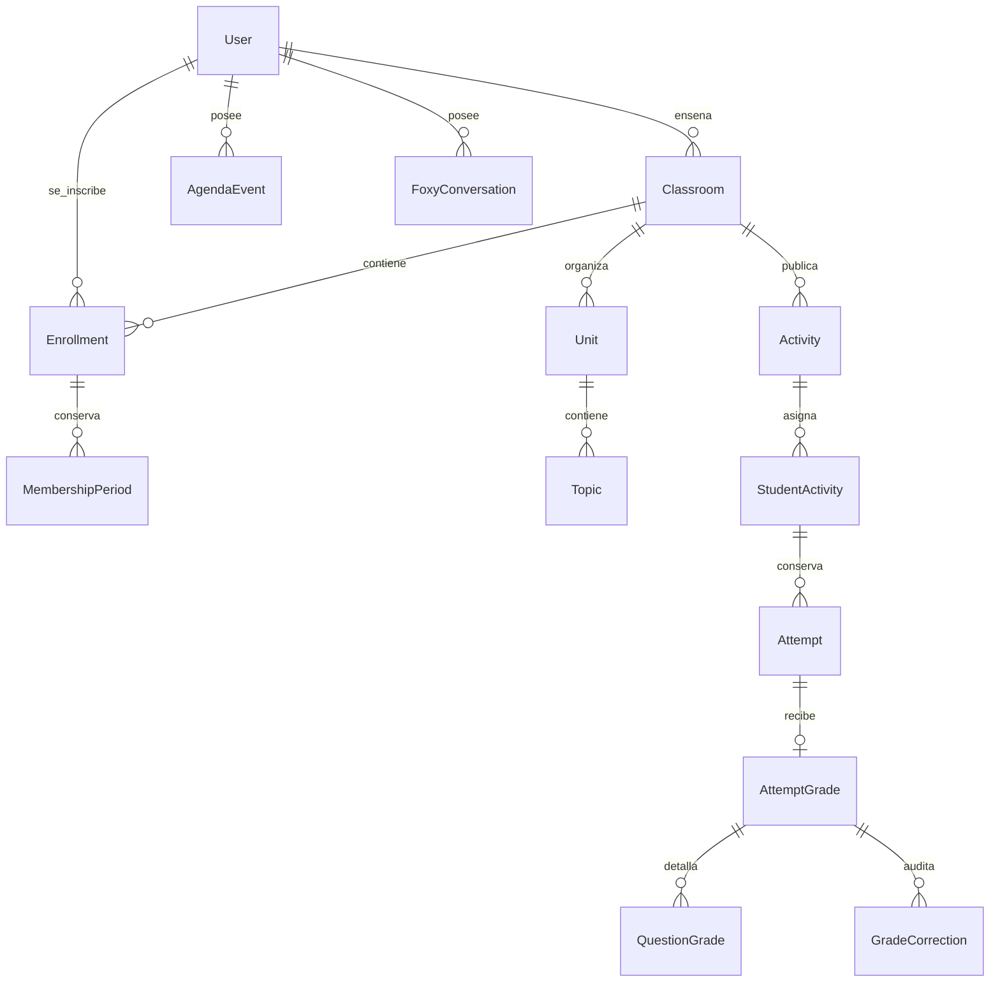

# Modelo de datos de FoxMind

El modelo físico vive en [schema.prisma](../../prisma/schema.prisma) y las restricciones adicionales en [migrations](../../prisma/migrations/). Al 18 de noviembre de 2026 hay 69 modelos Prisma y 68 migraciones SQL. SQL agrega checks, índices parciales y triggers que deben revisarse junto con el esquema.

## Entidades por dominio

Actualización Carpetas de estudio (2026-11-08): cuatro migraciones aditivas `202611080003`–`202611080006`. `StudyFolder` conserva dueño estudiante, estado, revisión y documento JSON versionado (plan, materiales, chats, prácticas, exámenes y recibos). `StudyFolderUpload` custodia cargas privadas con digests y estados; `StudyReviewSession` une sesión privada con evento/revisión de Agenda y aviso durable; `StudyAiDispatch` conserva admisión, deduplicación y presupuesto compartido. CHECKs e índices parciales permanecen en SQL. No se reescriben migraciones anteriores ni se convierten carpetas en aulas. [Reglas y conservación](study/README.md).

La revisión de Estudio del 2026-11-16 incorpora `subject` y `wizardStep` al documento JSON existente, sin migración SQL. Materia admite hasta 100 caracteres; el paso 0–3 sólo corresponde a borradores y se retira al activar. Omitir campos en PATCH conserva sus valores. Renombrar modifica únicamente el título de la conversación indicada y conserva turnos, propiedad, revisión y recibo idempotente.

Verificación de integración del 2026-11-10: la declaración Prisma de `StudyFolder` refleja los defaults `clock_timestamp()` y el índice nombrado `study_folders_owner_status_updated` ya definidos por la [migración existente](../../prisma/migrations/202611080003_study_folders/migration.sql). Es alineación declarativa con el modelo físico existente; no agrega migraciones ni modifica bases retenidas. El control `prisma migrate diff --from-config-datasource --to-schema prisma/schema.prisma --exit-code` retorna 0 sobre una base de prueba propia con las migraciones aplicadas.

Actualización 2026-11-08: migración `202611080001_pending_classroom_deletion` agrega `ClassroomDraft.deleted_at` para baja lógica irreversible desde UI. La restricción impide combinar borrador eliminado y aula publicada. Mantiene relaciones con archivos/extracciones y revisión concurrente; no elimina bytes ni registros dependientes. [Reglas](classrooms/README.md).

| Dominio | Modelos Prisma | Propiedad y relación principal |
|---|---|---|
| Contabilidad mensual IA | AiMonthlyReservation, AiMonthlyBudgetMovement, AiMonthlyProviderReceipt, AiMonthlyIntegrityCheck | Reserva por trabajo, cuenta y mes de origen con desglose de importes del usuario y de FoxMind. Los movimientos permiten reconstruir el saldo y los comprobantes externos quedan vinculados a una operación concreta. El historial de verificaciones conserva fecha y cantidad de discrepancias. |
| Identidad | User, Session, AccountToken, AccountActionControl | Usuario con rol exclusivo; sesiones/tokens asociados y controles de acciones |
| Agenda | AgendaEvent | Evento por cuenta, calendario local, zona, proyección temporal y configuración opcional de aviso |
| Aulas e ingreso | ClassroomDraft, Classroom, ClassroomCode, Invitation, ClassroomInvitationBatch, Enrollment, MembershipPeriod | Borrador y aula separados, código vigente con historial, lote recuperable por solicitud, decisión de invitación con fecha y destinatario, inscripción estable e historial de pertenencia |
| Plan | Unit, Topic, StudyPlanVersion | Unidades del aula, temas de unidad y versiones documentales del plan |
| Materiales y archivos | Material, MaterialRevision, FileObject, Upload, FileCustody | Recurso académico con descripción opcional, revisiones, metadatos de bytes, carga y custodia |
| Actividades | Activity, ActivityInstructionFile, ActivityMaterial, ActivityTopic, Question, QuestionOption | Actividad del aula con recursos, preguntas y temas ordenados de una o más unidades de la misma aula. La idea de IA queda en `Activity.teacher_brief` y en la carga privada del trabajo |
| Participación | StudentActivity, Attempt, Answer, AnswerSelection, AttemptAttachment | Obligación individual, intentos, respuestas y adjuntos por intento |
| Calificación | AttemptGrade, QuestionGrade, GradeCorrection | Corrección de intento, puntos por pregunta y auditoría de cambios publicados |
| Comunicación | WallPost, WallReply, Notification, NotificationProjectionRead | Publicaciones y respuestas por aula, avisos con destinatario y destino autorizado, y marcas de lectura por cuenta e identidad de proyección |
| Procesamiento y uso IA | BackgroundJob, ClassroomCurriculumExtraction, ClassroomAiRequest, AiUsageDaily, ActivityAiGeneration, ActivityAiRequest, StudentAiReport, GradingAiJob, AiExecutionPolicy | Trabajos, idempotencia, solicitudes, consumo, política técnica y resultados con alcance propio |
| Foxy: conversación y recursos | FoxyConversation, FoxyConversationRequest, FoxyTurn, FoxyResource, FoxyResourceRequest | Conversación docente privada, turnos, recursos derivados y estado durable de cancelación |
| Adjuntos privados del chat | ChatAttachment, FoxyChatAttachmentLink | Objeto privado con dueño, digest y estados de carga, revocación y limpieza; cada conversación docente conserva su vínculo de custodia. La copia estudiantil confirmada comparte bytes con su `StudyFolderUpload` |
| Foxy: publicación y visuales | FoxyPublication, FoxyPublicationConfirmRequest, FoxyPublicationCommandRequest, FoxyVisualAsset, FoxyPrivateAssetCommand, FoxyVisualJob | Confirmaciones y comandos, publicación, recursos privados y trabajos visuales |
| Carpetas de estudio | StudyFolder, StudyFolderUpload, StudyReviewSession, StudyAiDispatch | Dueño estudiante, estado privado versionado con carpeta y plan importable, custodia de archivos, sesiones de repaso y admisión de IA |

Creaciones es una consulta privada de esas entidades existentes, no una nueva entidad o copia. Su ID estable es el turno de herramienta o trabajo visual; un recurso materializado conserva el mismo resultado de catálogo. Los destinos se obtienen de publicaciones y recibos de traspaso con su material/actividad actual; el contexto de conversación no constituye una asignación. No se agrega migración para esta proyección.

## Relaciones principales

Es un subconjunto conceptual de cardinalidades físicas, no un esquema de migración. Los vínculos a archivos, temas múltiples, publicación efectiva y claves compuestas se consultan en Prisma/SQL.

## Invariantes que importan al modificarlo

- `User.avatar_key` conserva una elección del catálogo fijo Foxy o `initials` (default de cuentas nuevas/existentes), protegida por CHECK SQL. Es personalización de cuenta propia; no guarda URLs ni imágenes subidas.

- `User.account_role` identifica docente o estudiante; propiedad del aula y membresía siguen siendo condiciones adicionales. Una relación histórica no habilita acceso actual.
- ClassroomDraft conserva trabajo incompleto; publicar requiere construir un agregado válido. La existencia de un borrador no prueba un aula creada.
- Enrollment sobrevive a la salida; MembershipPeriod conserva períodos. StudentActivity separa obligación de intentos. El primer envío confirmado define puntualidad; reentregas no borran ese historial.
- FileObject y Upload distinguen custodia, validación, escaneo y transferencia. Material y MaterialRevision agregan significado académico; el recurso privado no es una URL pública permanente.
- Las claves compuestas impiden mezclar aula, actividad, pregunta, intento o archivo ajenos. Las operaciones deben conservar también la autorización y atomicidad del servicio.
- AttemptGrade mantiene datos privados hasta publicar. StudentActivity enlaza la calificación efectiva; GradeCorrection conserva auditoría. Sugerencia, nota final editable y publicación son estados distintos.
- Los puntos por pregunta conservan numerador/denominador; las notas usan NUMERIC sin redondeo silencioso de entradas. El cálculo y el formato pertenecen al motor de aplicación, no a la columna SQL.
- Los trabajos de Foxy conservan el estado de cancelación del dueño. Una respuesta tardía sin autorización de ejecución no se aplica. Estudio conserva la cancelación en el recibo de generación de la carpeta. Reintentar preparación o publicación para la misma revisión y destino reutiliza el resultado existente.
- El plan importado se guarda como copia editable en el documento de la carpeta. Los materiales del aula vinculada siguen siendo referencias autorizadas y se vuelven a verificar al leer o generar.
- La lectura de un aviso proyectado se guarda por cuenta e identidad de proyección. El origen vigente y su autorización determinan si una invitación, un ingreso o un aviso de evento sigue visible. Los repasos conservan la lectura en su sesión durable.

## Agenda: trazabilidad de invariantes físicos

`AgendaEvent` declara columnas, tipos, defaults, relación restrictiva con `User` e índice por dueño/fecha en [Prisma](../../prisma/schema.prisma). Los CHECKs viven en SQL, no quedan expresados por `String`, `Json` o `Int` de Prisma. Esta matriz es un recorte verificado de Agenda, no cobertura exhaustiva de los demás dominios.

| Invariante | Prisma / DDL que lo protege | Prueba SQL o de persistencia |
|---|---|---|
| Título recortado 1–160, descripción ≤4000, categoría CLASS/ACTIVITY/EVALUATION, revisión ≥0 y dueño existente | `title`, `description`, `category`, `revision`, `owner`; CHECKs y FK de [agenda_events](../../prisma/migrations/202610230001_agenda_events/migration.sql) | [agenda-database](../../tests/agenda-database.test.mjs): `database rejects invalid title/category/revision…`; límites válidos, rechazo 23514 y dueño inexistente 23503, sin cambiar la fila |
| Fechas con fin exclusivo posterior; ALL_DAY sin campos horarios; TIMED con locales, zona e instantes coherentes y offsets opcionales entre −1440 y 1440 | `schedule_kind`, fechas y campos horarios opcionales; `agenda_event_dates`, `agenda_event_schedule` y CHECK de kind en la misma migración | `SQL schedule…` y `SQL timed schedule…`: controles ALL_DAY/TIMED (UTC y no UTC), campos ausentes/mezclados, orden, proyección y extremos de offsets; rechazo 23514 sin cambios |
| NONE sin fin; DAILY/WEEKLY/MONTHLY con fin ≥ inicio y distancia <53 días / <371 días / <8 años | `repeat_kind`, `repeat_until`; CHECKs de [agenda_recurrence](../../prisma/migrations/202610280001_agenda_recurrence/migration.sql) reemplazan los originales | `SQL recurrence…`: inicio incluido, último permitido y primer excluido por kind, fin ausente/anterior y kind inválido; rechazo 23514 sin cambios |
| Excepciones JSON no nulas, array de hasta 53 entradas, default `[]` | `exceptions Json @default("[]")`; NOT NULL y `agenda_event_exceptions_array` de [agenda_occurrence_exceptions](../../prisma/migrations/202611050003_agenda_occurrence_exceptions/migration.sql) | `SQL exceptions…`: default, 0/53/54 entradas, JSON no-array y SQL NULL; rechazo 23514/23502 sin cambios |
| Color opcional, sin default, siete tokens admitidos (incluye GRAPHITE) | `color String?`; [agenda_event_color](../../prisma/migrations/202610240001_agenda_event_color/migration.sql) y ampliación [agenda_graphite_color](../../prisma/migrations/202611050006_agenda_graphite_color/migration.sql) | [agenda-event-color-database](../../tests/agenda-event-color-database.test.mjs): todos los tokens persisten, omisión limpia a NULL, colores SQL inválidos dan 23514 sin cambios; migración incremental conserva fila legacy |

Los casos de rechazo consultan filas completas después de recuperar el savepoint; comparan también revisión y cantidad de eventos. Los controles y cleanup usan la [fixture Docker propia](../../tests/agenda-database-helpers.test.mjs): PostgreSQL vacío en tmpfs, migraciones existentes, rollback por caso y limpieza sólo tras comprobar ownership. Comando focal: `node --test tests/agenda-database.test.mjs tests/agenda-event-color-database.test.mjs`; no usa `.env` ni bases retenidas.

### Límites de esta protección

- El CHECK de horario no valida que los offsets suministrados coincidan con la zona (sólo su rango), ni exige que `end_date_exclusive` sea la proyección exacta del fin horario. La resolución DST y otras reglas del calendario requieren validación de dominio; los casos SQL no certifican todos los valores malformados o zonas inválidas.
- El límite físico mensual es una ventana menor a ocho años, no un conteo de 53 ocurrencias. La generación de ocurrencias y su máximo pertenecen al dominio; estas pruebas caracterizan los bordes SQL, no todas las variantes de repetición.
- El CHECK de excepciones sólo valida contenedor y cantidad: no fechas, unicidad, pertenencia a la serie o estructura de cada elemento. Un array mixto y duplicados se aceptan a nivel SQL; no representan un payload válido del servicio.
- FK y revisión no conceden autorización ni implementan CAS por sí solas. Los casos existentes de servicio verifican persistencia, aislamiento por dueño y conflicto de revisión/color con autenticación sintética; sesiones/CSRF HTTP, upgrade de datos retenidos y el resto del esquema no quedan acreditados aquí. No se modifica ningún invariante ni runtime de base.

## Instantánea de ejecución IA

La [migración aditiva 202611160001](../../prisma/migrations/202611160001_ai_execution_profiles/migration.sql) agrega `execution_profile jsonb` nullable en `classroom_curriculum_extractions`, `activity_ai_generations`, `student_ai_reports`, `grading_ai_jobs`, `foxy_turns` y `study_ai_dispatches`. Los registros históricos conservan NULL; no se inventa un proveedor/modelo original ni se modifica su resultado. La generación visual queda fuera de este contrato textual.

El JSON `ai-execution-v1` guarda tarea, proveedor/modelo, ID/versión de perfil, versiones de prompt/respuesta, límites de entrada/salida/documentos/plazo y tarifas de entrada/salida por millón de tokens. Su contrato tiene campos cerrados, sin claves, prompts, documentos ni respuestas. CHECKs validan estructura y tarea; triggers impiden cambiar el snapshot de un trabajo. Los workers y la contabilidad usan esa identidad, sin resolver nuevamente el perfil activo para un trabajo ya creado.

`AiExecutionPolicy` representa `ai_execution_policy`: una única fila `singleton=true`, `baseline_profiles` inmutable, `active_profiles` validado y `updated_at`. Al crear trabajos con política vigente, el trigger exige snapshot no nulo e idéntico al perfil activo de su tarea. La creación de política y los cambios distintos al baseline se bloquean si `foxmind_ai_legacy_pending()` detecta trabajos NULL en `QUEUED`/`RUNNING` de las seis tablas. No se borra ni reescribe la historia para superar ese control.

Los pendientes legacy deben drenar con el ejecutor y configuración Gemini anteriores **antes del primer arranque de la nueva política**. Una política ya inicializada conserva el baseline para compatibilidad. El fence `application_name=foxmind-api-ai-execution-v1` protege frente a versiones incompatibles; no constituye una frontera de seguridad contra sesiones con permisos SQL. Ver [transición y configuración](local-development/README.md#perfiles-ia-y-transición-de-pendientes).

Estas declaraciones describen código y migración versionados. No acreditan aplicación sobre datos retenidos ni una verificación nueva de PostgreSQL en esta actualización documental.

## Cuota mensual de IA e imágenes privadas

`AiMonthlyReservation` identifica cada trabajo por espacio de nombres e ID y conserva dueño, herramienta, período, proveedor, modelo e importes de reserva y liquidación en microdólares. `AiMonthlyBudgetMovement` registra los movimientos con los que se reconstruyen los importes. `AiMonthlyProviderReceipt` impide aplicar dos veces la misma referencia de facturación del proveedor. `AiMonthlyIntegrityCheck` guarda el resultado del control interno diario. La vista `ai_monthly_operation_discrepancies` compara movimientos y reservas. El histórico diario sigue en `AiUsageDaily`. [Migración contable](../../prisma/migrations/202611180010_ai_monthly_budget/migration.sql) · [Control de integridad](../../prisma/migrations/202611180011_monthly_ai_integrity/migration.sql) · [Operación y conciliación](ai/README.md#cuota-mensual-por-cuenta).

`StudyImageAsset` relaciona carpeta y creación con dueño, tipo y bytes aprobados. La lectura exige acceso vigente a esa carpeta y su creación. La referencia y la creación se guardan dentro de la misma transacción. [Migración](../../prisma/migrations/202611180004_study_image_assets/migration.sql) · [Reglas de Estudio](study/README.md#contratos-y-operación).

## Conservación y eliminación

No hay una regla global de borrado en cascada para todo el producto. Las relaciones restrictivas, períodos, tombstones de comunicación, revisiones y auditorías preservan historia; los servicios definen qué puede eliminarse y cuándo limpiar bytes incompletos. Las políticas de [archivos](files/README.md), [participación](activities/participation.md), [calificaciones](grading/README.md) y [Foxy](ai/foxy.md) deben consultarse antes de diseñar una eliminación.

La capacidad de base no sustituye permisos HTTP, publicación docente, escaneo ni privacidad. Las [pruebas de base](local-development/database.md) acreditan ese nivel; su éxito no verifica toda la aplicación.

## Evolución del modelo

El candidato de Mis aulas del 2026-11-11 agrega `ClassroomInvitationBatch` mediante `202611110001_classroom_invitation_batches`: clave compuesta `(classroom_id, request_id)`, fecha y recibo cifrado. La referencia al aula es restrictiva. Conserva destinatarios y resultados para reconciliación/idempotencia; no incorpora una purga automática. La emisión de cada posición comparte transacción con Invitation y outbox. ClassroomCode conserva digest/envelope e historia global única: los códigos de seis dígitos revocados no se reasignan, por lo que el espacio finito requiere seguimiento de capacidad antes de una futura ampliación.

Las migraciones siguientes incorporan cambios de UX, ejecución IA y cuota. El orden de directorios sirve para ubicar los cambios. Para una instalación existente, consultá su registro de migraciones y la guía de transición.

| Migración | Cambio físico |
|---|---|
| [001 · Autoría interunidad](../../prisma/migrations/202611150001_activity_interunit_brief/migration.sql) | Agrega `activities.teacher_brief` opcional, de hasta 1200 caracteres. `activity_topics` referencia la actividad por aula y conserva la pertenencia del tema a su propia unidad del aula. |
| [002 · Formatos Office](../../prisma/migrations/202611150002_office_formats/migration.sql) | Amplía los CHECK de extensiones de `files` y `chat_attachments`. Los límites por propósito, inspección y escaneo se aplican en los servicios. |
| [003 · Agenda y lecturas](../../prisma/migrations/202611150003_agenda_projected_notifications/migration.sql) | Guarda minutos de anticipación y zona del aviso en `agenda_events`. Crea `notification_projection_reads` con clave compuesta `(user_id, notification_id)`. |
| [004 · Cancelación de Foxy](../../prisma/migrations/202611150004_foxy_cancellation/migration.sql) | Admite `CANCELLED` en turnos y trabajos visuales y actualiza las transiciones del trigger de trabajos visuales. |
| [006 · Rechazo de invitación](../../prisma/migrations/202611150006_invitation_decline/migration.sql) | Registra fecha y cuenta del rechazo. El índice parcial de invitaciones pendientes excluye las rechazadas. |
| [007 · Descripción de material](../../prisma/migrations/202611150007_material_description/migration.sql) | Agrega `materials.description` opcional, con límite de 2000 caracteres. Los vínculos siguen en `ActivityMaterial`. |
| [20261116-001 · Perfiles de ejecución IA](../../prisma/migrations/202611160001_ai_execution_profiles/migration.sql) | Agrega la política y las instantáneas de ejecución textual, manteniendo NULL en trabajos históricos. Ver [instantánea de ejecución IA](#instantánea-de-ejecución-ia). |
| [20261116-001 · Custodia de adjuntos Foxy](../../prisma/migrations/202611160001_foxy_attachment_links/migration.sql) | Agrega `foxy_chat_attachment_links` con claves compuestas de propietario y backfill de adjuntos docentes existentes. `cleanup_claimed_at` impide revivir objetos reclamados para limpieza. Las conversaciones comparten el objeto aprobado sin duplicar bytes. |
| [20261116-002 · Edición de visuales Foxy](../../prisma/migrations/202611160002_foxy_visual_editorial/migration.sql) | Agrega la revisión, el título y el texto editorial sobre el activo listo. La publicación conserva una instantánea independiente del archivo generado y de futuras ediciones; las filas y recibos previos siguen siendo legibles. |

| [20261118-001 · PDF etiquetado](../../prisma/migrations/202611180001_foxy_tagged_pdf/migration.sql) | Admite el renderizador PDF v2 y conserva los registros y archivos v1. |
| [20261118-003 · Rechazos de cuota](../../prisma/migrations/202611180003_monthly_quota_rejections/migration.sql) | Admite el motivo de cuota mensual en los estados de trabajo que informan el rechazo. |
| [20261118-004 · Imágenes privadas](../../prisma/migrations/202611180004_study_image_assets/migration.sql) | Guarda el activo aprobado con custodia de carpeta y creación. |
| [20261118-010 · Contabilidad mensual](../../prisma/migrations/202611180010_ai_monthly_budget/migration.sql) | Agrega reservas, movimientos y comprobantes por operación. |
| [20261118-011 · Integridad mensual](../../prisma/migrations/202611180011_monthly_ai_integrity/migration.sql) | Agrega la vista de diferencias y el registro de controles diarios. |

Una base que ya aplicó estas migraciones puede contener estados, vínculos, archivos y avisos nuevos. Volver a ejecutar el binario anterior no constituye una reversión de esos datos. Cualquier reversión requiere evaluar su compatibilidad, planificar una migración propia y probarla sobre una copia aislada. [Registro de migraciones y pruebas aisladas](../work-log/2026-11-15-activity_backend_impl-product-parity.md).

Actualizar Prisma y agregar una migración hacia adelante revisada, conservando checks, índices parciales y triggers SQL. Probar en una base aislada. No reescribir migraciones aplicadas ni usar db push/reset como sustituto sobre datos que deban conservarse. Una transición de roles o de conservación requiere decisión y plan explícitos.

Al agregar entidades, actualizar esta tabla, las relaciones afectadas y el contrato de su dominio; registrar criterios y prueba de migración conforme a la [política documental](../documentation-policy.md).
