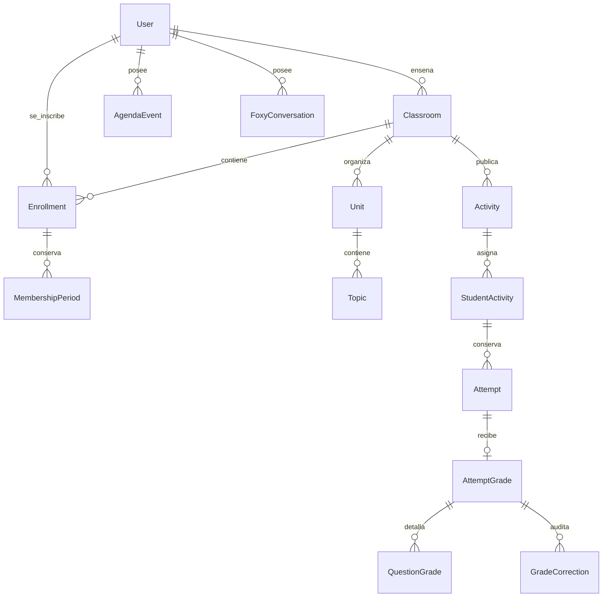

# Modelo de datos de FoxMind

El modelo físico vive en [schema.prisma](../../prisma/schema.prisma) y las restricciones adicionales en [migrations](../../prisma/migrations/). Este mapa explica responsabilidades y relaciones, sin duplicar cada campo. Corte documental del 2026-11-07: 55 modelos y 46 migraciones SQL; no es una lectura de ninguna base en ejecución.

## Entidades por dominio

Actualización 2026-11-08: migración `202611080001_pending_classroom_deletion` agrega `ClassroomDraft.deleted_at` para baja lógica irreversible desde UI. La restricción impide combinar borrador eliminado y aula publicada. Mantiene relaciones con archivos/extracciones y revisión concurrente; no elimina bytes ni registros dependientes. [Reglas](classrooms/README.md).

| Dominio | Modelos Prisma | Propiedad y relación principal |
|---|---|---|
| Identidad | User, Session, AccountToken, AccountActionControl | Usuario con rol exclusivo; sesiones/tokens asociados y controles de acciones |
| Agenda | AgendaEvent | Cada evento pertenece a una cuenta; conserva calendario local, zona y proyección temporal |
| Aulas e ingreso | ClassroomDraft, Classroom, ClassroomCode, Invitation, Enrollment, MembershipPeriod | Borrador y aula publicados separados; docente dueño, inscripción estable e historial de pertenencia |
| Plan | Unit, Topic, StudyPlanVersion | Unidades del aula, temas de unidad y versiones documentales del plan |
| Materiales y archivos | Material, MaterialRevision, FileObject, Upload, FileCustody | Recurso académico, revisiones, metadatos de bytes, carga y custodia |
| Actividades | Activity, ActivityInstructionFile, ActivityMaterial, ActivityTopic, Question, QuestionOption | Actividad del aula con contenido, recursos, temas asociados, preguntas y opciones |
| Participación | StudentActivity, Attempt, Answer, AnswerSelection, AttemptAttachment | Obligación individual, intentos, respuestas y adjuntos por intento |
| Calificación | AttemptGrade, QuestionGrade, GradeCorrection | Corrección de intento, puntos por pregunta y auditoría de cambios publicados |
| Comunicación | WallPost, WallReply, Notification | Publicaciones y respuestas por aula; avisos con destinatario y destino autorizado |
| Procesamiento y uso IA | BackgroundJob, ClassroomCurriculumExtraction, ClassroomAiRequest, AiUsageDaily, ActivityAiGeneration, ActivityAiRequest, StudentAiReport, GradingAiJob | Trabajos, idempotencia, solicitudes, consumo y resultados con alcance propio |
| Foxy: conversación y recursos | FoxyConversation, FoxyConversationRequest, FoxyTurn, FoxyResource, FoxyResourceRequest | Conversación docente privada, turnos y recursos derivados |
| Foxy: publicación y visuales | FoxyPublication, FoxyPublicationConfirmRequest, FoxyPublicationCommandRequest, FoxyVisualAsset, FoxyPrivateAssetCommand, FoxyVisualJob | Confirmaciones y comandos, publicación, recursos privados y trabajos visuales |

Creaciones es una consulta privada de esas entidades existentes, no una nueva entidad o copia. Su ID estable es el turno de herramienta o trabajo visual; un recurso materializado conserva el mismo resultado de catálogo. Los destinos se obtienen de publicaciones y recibos de traspaso con su material/actividad actual; el contexto de conversación no constituye una asignación. No se agrega migración para esta proyección.

## Relaciones principales

Es un subconjunto conceptual de cardinalidades físicas, no un esquema de migración. Los vínculos a archivos, temas múltiples, publicación efectiva y claves compuestas se consultan en Prisma/SQL.

## Invariantes que importan al modificarlo

- `User.account_role` identifica docente o estudiante; propiedad del aula y membresía siguen siendo condiciones adicionales. Una relación histórica no habilita acceso actual.
- ClassroomDraft conserva trabajo incompleto; publicar requiere construir un agregado válido. La existencia de un borrador no prueba un aula creada.
- Enrollment sobrevive a la salida; MembershipPeriod conserva períodos. StudentActivity separa obligación de intentos. El primer envío confirmado define puntualidad; reentregas no borran ese historial.
- FileObject y Upload distinguen custodia, validación, escaneo y transferencia. Material y MaterialRevision agregan significado académico; el recurso privado no es una URL pública permanente.
- Las claves compuestas impiden mezclar aula, actividad, pregunta, intento o archivo ajenos. Las operaciones deben conservar también la autorización y atomicidad del servicio.
- AttemptGrade mantiene datos privados hasta publicar. StudentActivity enlaza la calificación efectiva; GradeCorrection conserva auditoría. Sugerencia, nota final editable y publicación son estados distintos.
- Los puntos por pregunta conservan numerador/denominador; las notas usan NUMERIC sin redondeo silencioso de entradas. El cálculo y el formato pertenecen al motor de aplicación, no a la columna SQL.
- Jobs y solicitudes conservan identidad/deduplicación y estado. Un reintento debe respetar propiedad de ejecución, revisión, cuotas y confirmación; no puede crear publicaciones duplicadas.

## Conservación y eliminación

No hay una regla global de borrado en cascada para todo el producto. Las relaciones restrictivas, períodos, tombstones de comunicación, revisiones y auditorías preservan historia; los servicios definen qué puede eliminarse y cuándo limpiar bytes incompletos. Las políticas de [archivos](files/README.md), [participación](activities/participation.md), [calificaciones](grading/README.md) y [Foxy](ai/foxy.md) deben consultarse antes de diseñar una eliminación.

La capacidad de base no sustituye permisos HTTP, publicación docente, escaneo ni privacidad. Las [pruebas de base](local-development/database.md) acreditan ese nivel; su éxito no verifica toda la aplicación.

## Evolución del modelo

Actualizar Prisma y agregar una migración hacia adelante revisada, conservando checks, índices parciales y triggers SQL. Probar en una base aislada. No reescribir migraciones aplicadas ni usar db push/reset como sustituto sobre datos que deban conservarse. Una transición de roles o de conservación requiere decisión y plan explícitos.

Al agregar entidades, actualizar esta tabla, las relaciones afectadas y el contrato de su dominio; registrar criterios y prueba de migración conforme a la [política documental](../documentation-policy.md).
