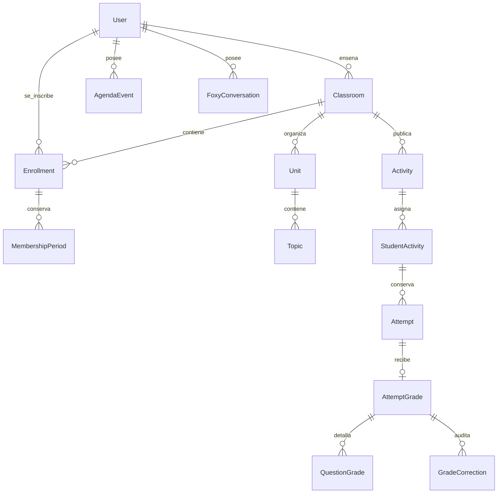

# Modelo de datos de FoxMind

El modelo físico vive en [schema.prisma](../../prisma/schema.prisma) y las restricciones adicionales en [migrations](../../prisma/migrations/). El candidato `398cc0b` contiene 61 modelos Prisma y 54 migraciones SQL. El conteo se obtiene del repositorio.

## Entidades por dominio

Actualización Carpetas de estudio (2026-11-08): cuatro migraciones aditivas `202611080003`–`202611080006`. `StudyFolder` conserva dueño estudiante, estado, revisión y documento JSON versionado (plan, materiales, chats, prácticas, exámenes y recibos). `StudyFolderUpload` custodia cargas privadas con digests y estados; `StudyReviewSession` une sesión privada con evento/revisión de Agenda y aviso durable; `StudyAiDispatch` conserva admisión, deduplicación y presupuesto compartido. CHECKs e índices parciales permanecen en SQL. No se reescriben migraciones anteriores ni se convierten carpetas en aulas. [Reglas y conservación](study/README.md).

Verificación de integración del 2026-11-10: la declaración Prisma de `StudyFolder` refleja los defaults `clock_timestamp()` y el índice nombrado `study_folders_owner_status_updated` ya definidos por la [migración existente](../../prisma/migrations/202611080003_study_folders/migration.sql). Es alineación declarativa con el modelo físico existente; no agrega migraciones ni modifica bases retenidas. El control `prisma migrate diff --from-config-datasource --to-schema prisma/schema.prisma --exit-code` retorna 0 sobre una base de prueba propia con las migraciones aplicadas.

Actualización 2026-11-08: migración `202611080001_pending_classroom_deletion` agrega `ClassroomDraft.deleted_at` para baja lógica irreversible desde UI. La restricción impide combinar borrador eliminado y aula publicada. Mantiene relaciones con archivos/extracciones y revisión concurrente; no elimina bytes ni registros dependientes. [Reglas](classrooms/README.md).

| Dominio | Modelos Prisma | Propiedad y relación principal |
|---|---|---|
| Identidad | User, Session, AccountToken, AccountActionControl | Usuario con rol exclusivo; sesiones/tokens asociados y controles de acciones |
| Agenda | AgendaEvent | Cada evento pertenece a una cuenta; conserva calendario local, zona y proyección temporal |
| Aulas e ingreso | ClassroomDraft, Classroom, ClassroomCode, Invitation, ClassroomInvitationBatch, Enrollment, MembershipPeriod | Borrador y aula separados, código vigente con historial, lote recuperable por solicitud, inscripción estable e historial de pertenencia |
| Plan | Unit, Topic, StudyPlanVersion | Unidades del aula, temas de unidad y versiones documentales del plan |
| Materiales y archivos | Material, MaterialRevision, FileObject, Upload, FileCustody | Recurso académico, revisiones, metadatos de bytes, carga y custodia |
| Actividades | Activity, ActivityInstructionFile, ActivityMaterial, ActivityTopic, Question, QuestionOption | Actividad del aula con contenido, recursos, temas asociados, preguntas y opciones |
| Participación | StudentActivity, Attempt, Answer, AnswerSelection, AttemptAttachment | Obligación individual, intentos, respuestas y adjuntos por intento |
| Calificación | AttemptGrade, QuestionGrade, GradeCorrection | Corrección de intento, puntos por pregunta y auditoría de cambios publicados |
| Comunicación | WallPost, WallReply, Notification | Publicaciones y respuestas por aula; avisos con destinatario y destino autorizado |
| Procesamiento y uso IA | BackgroundJob, ClassroomCurriculumExtraction, ClassroomAiRequest, AiUsageDaily, ActivityAiGeneration, ActivityAiRequest, StudentAiReport, GradingAiJob | Trabajos, idempotencia, solicitudes, consumo y resultados con alcance propio |
| Foxy: conversación y recursos | FoxyConversation, FoxyConversationRequest, FoxyTurn, FoxyResource, FoxyResourceRequest | Conversación docente privada, turnos y recursos derivados |
| Adjuntos privados del chat | ChatAttachment | Dueño, conversación, carpeta opcional, digest y estados de carga, revocación y limpieza. La copia estudiantil confirmada comparte bytes con su `StudyFolderUpload` |
| Foxy: publicación y visuales | FoxyPublication, FoxyPublicationConfirmRequest, FoxyPublicationCommandRequest, FoxyVisualAsset, FoxyPrivateAssetCommand, FoxyVisualJob | Confirmaciones y comandos, publicación, recursos privados y trabajos visuales |
| Carpetas de estudio | StudyFolder, StudyFolderUpload, StudyReviewSession, StudyAiDispatch | Dueño estudiante, estado privado versionado, custodia de archivos, eventos de repaso y admisión de IA |

Creaciones es una consulta privada de esas entidades existentes, no una nueva entidad o copia. Su ID estable es el turno de herramienta o trabajo visual; un recurso materializado conserva el mismo resultado de catálogo. Los destinos se obtienen de publicaciones y recibos de traspaso con su material/actividad actual; el contexto de conversación no constituye una asignación. No se agrega migración para esta proyección.

## Relaciones principales

Es un subconjunto conceptual de cardinalidades físicas, no un esquema de migración. Los vínculos a archivos, temas múltiples, publicación efectiva y claves compuestas se consultan en Prisma/SQL.

## Invariantes que importan al modificarlo

- `User.avatar_key` conserva una elección del catálogo fijo Foxy o `initials` (default de cuentas nuevas/existentes), protegida por CHECK SQL. Es personalización de cuenta propia; no guarda URLs ni imágenes subidas.

- `User.account_role` identifica docente o estudiante; propiedad del aula y membresía siguen siendo condiciones adicionales. Una relación histórica no habilita acceso actual.
- ClassroomDraft conserva trabajo incompleto; publicar requiere construir un agregado válido. La existencia de un borrador no prueba un aula creada.
- Enrollment sobrevive a la salida; MembershipPeriod conserva períodos. StudentActivity separa obligación de intentos. El primer envío confirmado define puntualidad; reentregas no borran ese historial.
- FileObject y Upload distinguen custodia, validación, escaneo y transferencia. Material y MaterialRevision agregan significado académico; el recurso privado no es una URL pública permanente.
- Las claves compuestas impiden mezclar aula, actividad, pregunta, intento o archivo ajenos. Las operaciones deben conservar también la autorización y atomicidad del servicio.
- AttemptGrade mantiene datos privados hasta publicar. StudentActivity enlaza la calificación efectiva; GradeCorrection conserva auditoría. Sugerencia, nota final editable y publicación son estados distintos.
- Los puntos por pregunta conservan numerador/denominador; las notas usan NUMERIC sin redondeo silencioso de entradas. El cálculo y el formato pertenecen al motor de aplicación, no a la columna SQL.
- Jobs y solicitudes conservan identidad/deduplicación y estado. Un reintento debe respetar propiedad de ejecución, revisión, cuotas y confirmación; no puede crear publicaciones duplicadas.

## Agenda: trazabilidad de invariantes físicos

`AgendaEvent` declara columnas, tipos, defaults, relación restrictiva con `User` e índice por dueño/fecha en [Prisma](../../prisma/schema.prisma). Los CHECKs viven en SQL, no quedan expresados por `String`, `Json` o `Int` de Prisma. Esta matriz es un recorte verificado de Agenda, no cobertura exhaustiva de los demás dominios.

| Invariante | Prisma / DDL que lo protege | Prueba SQL o de persistencia |
|---|---|---|
| Título recortado 1–160, descripción ≤4000, categoría CLASS/ACTIVITY/EVALUATION, revisión ≥0 y dueño existente | `title`, `description`, `category`, `revision`, `owner`; CHECKs y FK de [agenda_events](../../prisma/migrations/202610230001_agenda_events/migration.sql) | [agenda-database](../../tests/agenda-database.test.mjs): `database rejects invalid title/category/revision…`; límites válidos, rechazo 23514 y dueño inexistente 23503, sin cambiar la fila |
| Fechas con fin exclusivo posterior; ALL_DAY sin campos horarios; TIMED con locales, zona e instantes coherentes y offsets opcionales entre −1440 y 1440 | `schedule_kind`, fechas y campos horarios opcionales; `agenda_event_dates`, `agenda_event_schedule` y CHECK de kind en la misma migración | `SQL schedule…` y `SQL timed schedule…`: controles ALL_DAY/TIMED (UTC y no UTC), campos ausentes/mezclados, orden, proyección y extremos de offsets; rechazo 23514 sin cambios |
| NONE sin fin; DAILY/WEEKLY/MONTHLY con fin ≥ inicio y distancia <53 días / <371 días / <8 años | `repeat_kind`, `repeat_until`; CHECKs de [agenda_recurrence](../../prisma/migrations/202610280001_agenda_recurrence/migration.sql) reemplazan los originales | `SQL recurrence…`: inicio incluido, último permitido y primer excluido por kind, fin ausente/anterior y kind inválido; rechazo 23514 sin cambios |
| Excepciones JSON no nulas, array de hasta 53 entradas, default `[]` | `exceptions Json @default("[]")`; NOT NULL y `agenda_event_exceptions_array` de [agenda_occurrence_exceptions](../../prisma/migrations/202611050003_agenda_occurrence_exceptions/migration.sql) | `SQL exceptions…`: default, 0/53/54 entradas, JSON no-array y SQL NULL; rechazo 23514/23502 sin cambios |
| Color opcional, sin default, siete tokens admitidos (incluye GRAPHITE) | `color String?`; [agenda_event_color](../../prisma/migrations/202610240001_agenda_event_color/migration.sql) y ampliación [agenda_graphite_color](../../prisma/migrations/202611050006_agenda_graphite_color/migration.sql) | [agenda-event-color-database](../../tests/agenda-event-color-database.test.mjs): todos los tokens persisten, omisión limpia a NULL, colores SQL inválidos dan 23514 sin cambios; migración incremental conserva fila legacy |

Los casos de rechazo consultan filas completas después de recuperar el savepoint; comparan también revisión y cantidad de eventos. Los controles y cleanup usan la [fixture Docker propia](../../tests/agenda-database-helpers.test.mjs): PostgreSQL vacío en tmpfs, migraciones existentes, rollback por caso y limpieza sólo tras comprobar ownership. Comando focal: `node --test tests/agenda-database.test.mjs tests/agenda-event-color-database.test.mjs`; no usa `.env` ni bases retenidas.

### Límites de esta protección

- El CHECK de horario no valida que los offsets suministrados coincidan con la zona (sólo su rango), ni exige que `end_date_exclusive` sea la proyección exacta del fin horario. La resolución DST y otras reglas del calendario requieren validación de dominio; los casos SQL no certifican todos los valores malformados o zonas inválidas.
- El límite físico mensual es una ventana menor a ocho años, no un conteo de 53 ocurrencias. La generación de ocurrencias y su máximo pertenecen al dominio; estas pruebas caracterizan los bordes SQL, no todas las variantes de repetición.
- El CHECK de excepciones sólo valida contenedor y cantidad: no fechas, unicidad, pertenencia a la serie o estructura de cada elemento. Un array mixto y duplicados se aceptan a nivel SQL; no representan un payload válido del servicio.
- FK y revisión no conceden autorización ni implementan CAS por sí solas. Los casos existentes de servicio verifican persistencia, aislamiento por dueño y conflicto de revisión/color con autenticación sintética; sesiones/CSRF HTTP, upgrade de datos retenidos y el resto del esquema no quedan acreditados aquí. No se modifica ningún invariante ni runtime de base.

## Conservación y eliminación

No hay una regla global de borrado en cascada para todo el producto. Las relaciones restrictivas, períodos, tombstones de comunicación, revisiones y auditorías preservan historia; los servicios definen qué puede eliminarse y cuándo limpiar bytes incompletos. Las políticas de [archivos](files/README.md), [participación](activities/participation.md), [calificaciones](grading/README.md) y [Foxy](ai/foxy.md) deben consultarse antes de diseñar una eliminación.

La capacidad de base no sustituye permisos HTTP, publicación docente, escaneo ni privacidad. Las [pruebas de base](local-development/database.md) acreditan ese nivel; su éxito no verifica toda la aplicación.

## Evolución del modelo

El candidato de Mis aulas del 2026-11-11 agrega `ClassroomInvitationBatch` mediante `202611110001_classroom_invitation_batches`: clave compuesta `(classroom_id, request_id)`, fecha y recibo cifrado. La referencia al aula es restrictiva. Conserva destinatarios y resultados para reconciliación/idempotencia; no incorpora una purga automática. La emisión de cada posición comparte transacción con Invitation y outbox. ClassroomCode conserva digest/envelope e historia global única: los códigos de seis dígitos revocados no se reasignan, por lo que el espacio finito requiere seguimiento de capacidad antes de una futura ampliación.

Actualizar Prisma y agregar una migración hacia adelante revisada, conservando checks, índices parciales y triggers SQL. Probar en una base aislada. No reescribir migraciones aplicadas ni usar db push/reset como sustituto sobre datos que deban conservarse. Una transición de roles o de conservación requiere decisión y plan explícitos.

Al agregar entidades, actualizar esta tabla, las relaciones afectadas y el contrato de su dominio; registrar criterios y prueba de migración conforme a la [política documental](../documentation-policy.md).
