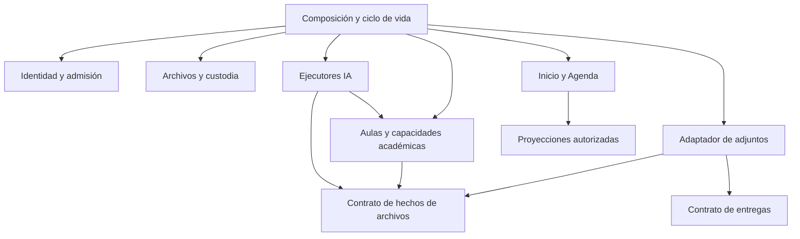

# ARQ-03 — propuesta de límites y alternativas

Fecha: 2026-11-02. **Diseño aprobado por el usuario; ARQ-03 completed. Alternativa B, contrato de extracción y excepciones aprobados. Implementación no autorizada por este cierre.**

Base inspeccionada: `main`, commit `add38ec16a6f03e4e4332288b198036161e4cf58`, con cambios locales de ARQ-02 y trabajo ajeno preservados. [Plan único](architecture-consolidation.md), [alcance aprobado ARQ-01](architecture-consolidation-arq01-matrix.md), [ARQ-02 completada y límites de verificación](../../docs/work-log/2026-11-02-id-unavailable-arq02-verification.md), [registro de esta tarea](../../docs/work-log/2026-11-02-id-unavailable-arq03-design.md).

## Qué se propone decidir

Mantener el monolito modular y su stack. Recomiendo **B: extracciones graduales por capacidad**, empezando por el vínculo entre archivos y entregas. Cada capacidad pasa a decidir y escribir sus propias reglas mediante operaciones pequeñas. La aplicación sigue coordinando una única transacción cuando la atomicidad actual lo exige. No se proponen nuevos servicios, infraestructura, tablas ni cambios de producto.

Este diseño define dirección, responsabilidades y una primera extracción verificable. No aprueba el despiece completo de Classrooms ni convierte cada capacidad en un paquete obligatorio. La nomenclatura de contratos es orientativa; sus garantías y dependencias forman parte de lo aprobado.

## ADR ARQ-03 — extracción gradual por capacidades

- Estado y fecha: aprobado por el usuario el 2026-11-02. Decisión humana: «Apruebo el diseño de ARQ-03 con la alternativa B, el contrato de extracción y las excepciones propuestas. Registrá el cierre de ARQ-03.»
- Contexto: la composición actual funciona, pero Files decide reglas académicas y escribe asociaciones de entregas; la fachada y accesos a infraestructura amplían el acoplamiento. Las alternativas A/B/C y sus consecuencias se conservan abajo.
- Decisión: adoptar B, extracciones graduales dentro del monolito y stack actuales. Aprobar el contrato transaccional del bridge de adjuntos y las excepciones temporales delimitadas de este documento, incluyendo lectores Inicio/Agenda.
- Consecuencias: la primera extracción conserva autorización síncrona, atomicidad, errores, editor, cupos, reservas y revalidación. La convivencia se controla por contratos y excepciones concretas con condiciones de retirada; no se exige reescritura completa ni se crean módulos vacíos. Las decisiones de producto PD siguen abiertas.
- Alcance de autoridad: aprobación del diseño y cierre documental de ARQ-03. ARQ-04 y siguientes permanecen sin iniciar; requieren asignación de ejecución explícita. No autoriza código, datos, commits ni publicación.

## Arquitectura observada y costo de conservarla

La [arquitectura vigente](../../docs/engineering/architecture.md) compone Next/BFF, Nest, capacidades y puertos sobre PostgreSQL, almacenamiento privado y adaptadores externos. La raíz de composición instala módulos y transportes; el apagado drena trabajos antes de cerrar infraestructura (`apps/api/src/application.ts:61`, `apps/api/src/application.ts:77`). Esa composición central es útil y se conserva.

| Relación actual | Evidencia inspeccionada | Consecuencia para el diseño |
|---|---|---|
| Classrooms compone servicios especializados, pero expone `ports`, `tokens`, `run` y resolución genérica de aula | `apps/api/src/classrooms/composition.ts:25`, `apps/api/src/classrooms/composition.ts:141` | Existe separación interna aprovechable; consumidores pueden alcanzar detalles y SQL con demasiado poder |
| Files importa política académica y escribe asociaciones/revisiones de intentos | `apps/api/src/files/attempt-bridge.ts:2`, `apps/api/src/files/attempt-bridge.ts:32`, `apps/api/src/files/attempt-bridge.ts:49` | La custodia de bytes conoce edición, recepción y reglas de entrega |
| Files también consulta pertenencia, archivo y vínculos académicos fuera del bridge | `apps/api/src/files/store.ts:53`, `apps/api/src/files/access.ts:7` | Extraer el bridge no equivale a eliminar todo el acoplamiento académico de Files |
| El host de Files instala directamente ambos callbacks académicos | `apps/api/src/files/files.module.ts:2`, `apps/api/src/files/files.module.ts:22` | Hay un punto concreto para inyectar integración sin importar Classrooms desde Files |
| Generación de actividades usa base/autenticación desde `classrooms.ports` y su guardia genérica | `apps/api/src/classrooms/activity-ai/database.ts:6` | Conviene separar la ejecución autorizada de las herramientas internas de composición |
| Foxy obtiene almacenamiento y store del servicio Files | `apps/api/src/foxy-ai/runtime.ts:111`, `apps/api/src/foxy-ai/runtime.ts:121` | Un servicio amplio no debe funcionar como localizador de infraestructura para consumidores |
| Agenda escribe eventos privados y consume una proyección académica; Inicio compone lecturas SQL | `apps/api/src/agenda/unit-of-work.ts:12`, `apps/api/src/agenda/event-repository.ts:25`, `apps/api/src/home/unit-of-work.ts:6`, `apps/api/src/home/queries-participation.ts:4` | Conservar proyecciones autorizadas y distinguirlas de propiedad de escritura |
| El control AST permite barrels y excepciones históricas; no cubre aún todos los tipos de importación | `scripts/check-boundaries.mjs:1`, `scripts/boundary-legacy-edges.mjs:1` | Un import permitido no demuestra un contrato pequeño; ARQ-04 debe cerrar el escape de tipos inline |

Conservar todo igual exige revisar cada cambio académico también en Files, mantener excepciones amplias y conocer el contexto completo de la fachada. Mover archivos o añadir barrels por sí solo no reduce ese costo. Se observa dependencia bidireccional entre áreas; no se demostró un defecto de inicialización ni se equipara un ciclo de tipos con un ciclo de ejecución.

## Alternativas viables

| Opción | Qué cambia | Ventajas | Costos, riesgos y mantenimiento |
|---|---|---|---|
| A. Conservar la composición y acotar accesos | Mantener fachada y ubicación del bridge; publicar contratos más estrechos y reforzar controles | Menor cambio inicial; fácil seguimiento para quien conoce el código; mismos costos operativos | Retiene propiedad de escritura cruzada y política duplicada. Cada excepción necesita mantenimiento; menor reducción del riesgo de permisos. Viable si se prioriza estabilización inmediata |
| **B. Extraer por capacidad de forma gradual** | Extraer primero política/asociación de adjuntos; después reducir fachada y adaptar consumidores uno por uno | Mejora propiedad y pruebas con cambios revisables; preserva atomicidad y stack; permite detenerse tras cada extracción | Costo intermedio de adaptadores y convivencia temporal; requiere controlar que los nuevos contratos no recreen una fachada genérica. Recomendación para el alcance aprobado |
| C. Dividir Classrooms en una entrega amplia | Separar aulas, enseñanza, entregas, evaluación y sus consumidores coordinadamente | Propiedad más uniforme al finalizar; menos período de convivencia | Mayor superficie simultánea de regresión, revisión y conflictos; exige conocer más invariantes antes de tocar nada. Mismo costo de infraestructura, mayor costo de ingeniería y transferencia de conocimiento. Viable con tiempo/equipo dedicados, innecesaria para el primer resultado |

No se dispone de medición nueva de rendimiento ni estimación económica del equipo. La comparación es cualitativa sobre el código actual. Ninguna opción requiere aprender un stack nuevo. Reevaluar B si la primera extracción exige cambiar producto/esquema, introduce una transacción distribuida, no reduce dependencias o amplía de manera desproporcionada el contrato público. En ese caso volver al diseño; no convertir la dificultad en permiso de reescritura.

## Mapa propuesto y dependencias permitidas

Las flechas indican dependencia de contrato, no llamadas HTTP ni nuevos procesos. El adaptador conecta callbacks de Files con Entregas; Files declara el puerto que necesita y no importa su implementación académica. Entregas recibe hechos de archivos mediante un contrato pequeño; no importa el servicio Files. La raíz compone ambos sin un ciclo de ejecución entre servicios. Los contratos compartidos deben carecer de efectos de inicialización.

Reglas propuestas:

- Composición/host puede construir adaptadores, abrir infraestructura y administrar apagado. No aloja reglas académicas ni se convierte en API de consumo.
- Cada capacidad decide sus invariantes y es responsable de sus escrituras. Otra capacidad solicita una operación; no actualiza sus tablas directamente. Los cambios de revisión y notificaciones que acompañan esa operación deben quedar explícitos en su contrato.
- Las operaciones transaccionales aceptan exclusivamente la transacción activa y un contexto autorizado; no abren otra transacción ni hacen llamadas externas. Exponer `query` dentro de esta integración local no ofrece aislamiento efectivo por sí solo: se controla por ubicación, revisión y pruebas. No se afirma protección física de tablas.
- Consumidores usan DTO y operaciones específicas. `ports`, `tokens`, `run`, `store`, `storage` y `scanner` no son API pública de negocio. Se retiran gradualmente de los consumidores existentes; no se rompe la composición antes de migrarlos.
- No se agregan accesos nuevos mediante barrels amplios. ARQ-04 debe distinguir contrato de consumo, API de host y excepciones concretas, incluyendo imports inline de tipos y ciclos de valores frente a tipos. El inventario actual de excepciones es un punto de partida, no aprobación automática de todas sus entradas.

## Propiedad de datos y operaciones

Los nombres siguientes son capacidades lógicas propuestas, no tablas nuevas ni paquetes obligatorios. La columna actual identifica escrituras relevantes, no un inventario exhaustivo de cada sentencia SQL. Antes de extraer cada capacidad se completa su inventario puntual.

| Datos / escritura actual relevante | Propietario propuesto | Lectores / operaciones públicas | Invariantes y transacción | Excepción o límite de esta etapa |
|---|---|---|---|---|
| Cuenta, rol global, sesiones y verificación: Identity; Files/Agenda revalidan usuario | Identidad | Hosts: autenticar/revalidar; consumidores: identidad mínima autorizada | Rol global exclusivo vigente, sesión/Origin/CSRF y bloqueo/revalidación actuales | No duplicar identidad en capacidades ni habilitar doble rol por el mapa |
| Aula, archivo/reactivación, participación e invitaciones: servicios de Classrooms | Aulas y participación | Enseñanza/entregas/evaluación solicitan contexto y permiso; Inicio/Agenda leen proyecciones | Docente y pertenencia por aula; historial y períodos; cambios de archivo serializados | Guardias transaccionales compartidas permitidas; no autoridad institucional implícita |
| Borrador y plan/versiones: Draft/Plan; promoción toca custodia Files | Enseñanza para plan; Files para custodia | Publicar plan y promover custodia por operación específica | Propietario y revisión; promoción/creación en transacción existente; reintentar conflicto de scope | Mantener integración de promoción y orden de locks hasta diseñar su extracción puntual |
| Actividades, preguntas, publicación y obligaciones: autoría/participación de Classrooms | Enseñanza y participación | Crear/publicar/revisar; Entregas obtiene recepción/obligación autorizadas | Revisión, estado publicado, elegibilidad y primera participación | Sin API genérica para actualizar actividades desde IA |
| Intentos, respuestas y selección de adjuntos: Practical/Questionnaire; bridge Files inserta vínculo y revisión | Entregas | Abrir/editar/confirmar intento; autorizar adjunto y asociarlo al quedar listo | Editor/epoch distinto de revisión; recepción y archivo; máximo cinco, idempotencia y revisión en misma transacción | Primera extracción descrita abajo; no cambiar evaluación ni tiempos |
| Files/uploads/custodias/reservas/estado de escaneo: Files | Archivos | Iniciar/cargar/consultar/leer autorizado; hechos de reserva/custodia y promoción | Cuota de almacenamiento vigente, digest, lease, scan y limpieza; nunca exposición pública del blob | Lecturas de scope/pertenencia/vínculos todavía explícitas y transitorias |
| Notas, correcciones, publicación y nota efectiva: Grading/GradePublication | Evaluación | Corregir/publicar/leer según actor | Publicación actualiza nota efectiva y notificación atómicamente (`apps/api/src/classrooms/grade-publication.ts:61`) | `student_activities` tiene campos de participación y nota efectiva: propiedad por operación/campo, no por tabla completa |
| Materiales/vínculos y revisión de aula: Library/publicación desde Foxy | Biblioteca/enseñanza | Publicar material autorizado; Files custodia y elimina bytes cuando corresponda | Asociación académica y revisión juntas; sin borrado físico prematuro (`apps/api/src/classrooms/library-publication.ts:26`) | Mantener llamada transaccional actual; migrar acceso a FileStore por contrato estrecho en su propia unidad |
| Notificaciones generadas por operaciones académicas y lectura del destinatario | Capacidad emisora para evento; notificaciones para lectura/entrega | Registrar evento en transacción; listar/marcar propias; host entrega correo | No adelantar correo al commit ni conceder permisos por notificación | No imponer bus/outbox nuevo; inventariar rutas existentes antes de cambiar implementación |
| Progreso y resumen: Progress y consultas | Proyecciones académicas | Consultar progreso por permisos actuales | Finalización, rendimiento y avance del plan separados | No reutilizar proyección individual como reporte institucional |
| Agenda escribe `agenda_events`; Inicio solo lee módulos | Agenda personal / Inicio como lector | CRUD propio; agenda académica y módulos de Inicio | Dueño del evento, CAS y revalidación; Inicio rechaza `write` | SQL de proyección permitido con filtros/autenticación actuales; no escritura académica desde lectores |
| Jobs/intentos técnicos/reservas de gasto IA: runtimes actuales; Foxy publica mediante capacidades | Ejecución técnica IA y capacidad académica destino | Preparar/ejecutar/cancelar/diagnosticar; aplicar propuesta por operación del destino | Autorización, idempotencia, lease, presupuesto técnico y apagado actuales | ARQ-08 revisa coordinación entre colas; no unificar comerciales con gasto técnico |

No se traslada automáticamente `classrooms.revision` a cada servicio independiente: su actualización sigue siendo parte de operaciones coordinadas existentes. Las cuotas actuales de almacenamiento y proveedor no representan una licencia comercial.

## Primera extracción propuesta: adjuntos de entregas

**Resultado esperado en ARQ-05:** Files conserva custodia, validación y escaneo; Entregas decide si se puede editar y escribe `attempt_attachments` y la revisión del intento. No cambia el comportamiento observable ni los endpoints.

### Contratos candidatos

1. Puerto requerido por Files: autorizar escritura de adjunto dentro de la transacción y notificar una transición efectiva a listo. Entrada mínima: actor autenticado, aula/intento/archivo, credencial de editor y contexto de operación. No aceptar `actorId` arbitrario desde el body. Extraer headers en el adaptador sin cambiar su validación ni los errores actuales.
2. Contrato de Entregas: comprobar recepción/editor/elegibilidad y asociar adjunto listo. No devuelve `AttemptRow`, servicio de Classrooms, tokens ni capacidad de ejecutar SQL arbitrario al consumidor.
3. Contrato de hechos Files ligado a la transacción: validar custodia no cancelada/rechazada y contar reservas pendientes de adjuntos para un intento excluyendo el archivo actual. Entregas combina esa cuenta con asociaciones seleccionadas. Debe conservar la exclusión de reservas ya asociadas y de archivos completados deliberadamente no seleccionados. Una cuenta leída fuera del bloqueo/transacción no es válida para autorizar.
4. Adaptador de composición: conecta estos contratos y traduce denegaciones académicas al contrato Files vigente: `FORBIDDEN`, `INVALID_UPLOAD`, `UPLOAD_CONFLICT`, `SERVICE_UNAVAILABLE`. Conservar distinción con errores de identidad y fallas del driver; no introducir un fallback permisivo.

Los hechos Files deben expresarse mediante tipos sin importar la implementación de Files desde Entregas. El puerto de hechos puede residir junto a Entregas y ser implementado por el adaptador usando API Files. La composición construye funciones ligadas a la transacción, sin necesidad de servicios que se inyecten recíprocamente. No crear un repositorio compartido con acceso universal.

### Secuencia y garantías que se preservan

El flujo actual autentica, bloquea/revalida usuario y scope, verifica pertenencia y política, realiza almacenamiento/escaneo fuera de la transacción final y vuelve a autorizar en ella (`apps/api/src/files/store.ts:67`, `apps/api/src/files/service.ts:123`). En esa transacción final comprueba operación/lease, marca limpio/completado/listo y ejecuta el callback antes del commit (`apps/api/src/files/service.ts:125`). Si la asociación falla, la transición final revierte; el manejo de fallo/limpieza existente sigue aplicando. No mover scanner ni I/O dentro de ese bloqueo.

La extracción debe conservar los sitios y orden de adquisición actuales: usuario/scope en FileStore; resolución de intento, actividad, inscripción/obligación y membresía en la política; custodia/upload y asociaciones donde hoy se bloquean. El orden textual de tablas en una consulta no demuestra el orden interno del motor. No se rediseñan locks en esta entrega: antes de modificar cualquier orden, documentar interleavings y probar concurrencia.

La política actual bloquea aula y registros académicos, verifica intento propio, membresía activa, publicación, obligación y recepción con reloj de base (`apps/api/src/classrooms/attempt-access.ts:20`, `apps/api/src/classrooms/attempt-access.ts:47`). La revisión opcional es CAS independiente; no exigirla al cargar archivos, porque una respuesta o carga confirmada no revoca el editor vigente. El bridge impone TP, máximo cinco entre selección y reservas, `ON CONFLICT DO NOTHING` y revisión solo si inserta (`apps/api/src/files/attempt-bridge.ts:8`, `apps/api/src/files/attempt-bridge.ts:56`). Esas garantías son aceptación, no oportunidades de simplificación.

No se promete que esta primera extracción elimine el SQL académico de `files/access.ts` o `FileStore`. Se documenta y controla hasta migrar las decisiones restantes por propósito (plan/material/instrucciones/adjuntos), en unidades posteriores aprobadas. Mover todo ese SQL de una vez ampliaría el riesgo de lectura privada y permisos.

### Aceptación y evidencia a obtener al implementar

| Prueba necesaria | Base existente inspeccionada / acción futura |
|---|---|
| El bridge rechaza editor ausente/malformado y propósito inválido, conserva errores | `tests/p7-practical-bridge.test.mjs:7`; adaptar import a la nueva ubicación y completar casos del puerto sin debilitar aceptación |
| Éxito enlaza una vez, incrementa revisión una vez; reintento no duplica | Añadir prueba focal de integración transaccional: callback/commit/rollback y repetición real |
| Carrera por el quinto cupo, reservas incompletas, archivo actual excluido y completados no seleccionados | Añadir/verificar casos DB con transacciones concurrentes; un mock de count no demuestra serialización |
| Archivo/reactivación, revocación de sesión/membresía, epoch obsoleto, límite temporal y scan fallido durante carga | Seleccionar casos de `tests/p7-practical-integration.test.mjs`, `tests/p7-practical-timing-integration.test.mjs` y completar huecos al especificar extracción |
| Mismos estados HTTP, identidad/admisión, almacenamiento privado y scanner; no borrado ajeno | Reusar ruta desechable registrada por ARQ-02 y verificar limpieza/ownership; sin proveedores IA reales ni datos retenidos |
| Files no importa implementación Classrooms; consumidores no reciben store/SQL por nuevo contrato | ARQ-04 debe comprobar import normal, type-only, inline y ciclos; verificar API estricta y ausencia de nuevas excepciones amplias |

Estas son pruebas existentes o cobertura requerida, **no pruebas ejecutadas en ARQ-03**. La prueba de navegador existente arranca un runtime y no fue ejecutada aquí. ARQ-02 aporta una base fechada con sus límites; no certifica código que todavía no existe.

## APIs de host, consumo y excepciones transitorias

| Superficie | Regla propuesta / tratamiento | Etapa y condición de retirada |
|---|---|---|
| Módulos Nest, configuración, arranque/apagado, adaptadores DB/storage/scanner | API host explícita; solo composición importa constructores/infraestructura. Preservar orden de cierre y receptor de callbacks | ARQ-04 clasificación; cambios puntuales en ARQ-05/08 |
| `ClassroomService.ports`, `tokens`, `run`, `classroom` | No API de consumo nueva. Enumerar consumidores y reemplazar por operaciones de capacidad/ejecución autorizada acotada | ARQ-06; retirar cada acceso solo tras paridad de identidad, locks y errores |
| `FileService.store/storage/scanner`, `FileStore` expuesto desde contratos | Sustituir en consumidores por lectura privada/publicación/custodia específica; el host conserva infraestructura para lifecycle | ARQ-05 para bridge; ARQ-06/07/08 según consumidor. No esconder el mismo servicio amplio bajo otro nombre |
| SQL académico en Files/access/store | Excepción delimitada a código y propósitos existentes; mantener guardias, sin nuevos escritores académicos | Bridge retirado en ARQ-05; resto necesita inventario/aceptación puntual, no permiso abierto |
| Promoción de borrador y publicación de biblioteca con Files | Integración transaccional explícita; Files escribe custodia y capacidad académica asociación/revisión | ARQ-06 o unidad aprobada; no separar commits para aparentar independencia |
| Inicio SQL sobre tablas académicas; Agenda mediante proyección de Classrooms | Excepción de lectura de proyección, no repositorio universal; filtros actor/aula y revalidación obligatorios | ARQ-06/07 evalúan costo de encapsulación; conservar si no hay ganancia comprobable al moverla |
| Colas IA consultan ejecución compartida y presupuesto técnico | Excepción de coordinación técnica actual, separada de reglas comerciales | ARQ-08 inventario de lease/reintento/idempotencia antes de extraer; sin cambiar polling/infra por inferencia |
| Token `InvitationService` representa una fachada `ClassroomService` en composición | Migrar nombre/token con usos reales; no asumir que solo maneja invitaciones (`apps/api/src/application.ts:81`) | ARQ-06; misma instancia/configuración/transportes y verificación de DI |

Cada excepción que pase al control debe tener origen/destino exactos, motivo, responsable lógico, prueba y condición de retirada. Esta tabla es diseño de tratamiento, no reemplazo del inventario de imports vigente ni autorización para sumar excepciones. No borrar en masa `legacyEdges` porque un barrel pase el checker.

## Límites futuros separados del refactor

La fuente externa de negocio conserva SHA-256 `1a0adba05a18a555ae2e163c651a0fc9f7003efbd94e1b9c96d0da3e7e6e8fc2`, contrastado nuevamente con el plan. La matriz aprobada ARQ-01 gobierna diferencias y separa contrato vigente de propuestas; PT no es aprobación.

| Entrega futura / decisiones humanas | Consecuencia de límite, sin implementarla |
|---|---|
| Aulas: transferencia/co-docencia y roles (PD-02/04/21), salida archivada y ocultamiento | Conservar rol global exclusivo y estado/operaciones actuales. Transferencia, ocultar, salir, archivar y eliminar requieren contratos distintos; no añadirlos en refactor |
| Instituciones: representación y vínculo (PD-03/20) | Una relación institucional no concede administración del aula, identidad privilegiada ni permiso sobre archivos; representación requiere aprobación propia |
| Reportes agregados (PD-06/07) | Lectura agregada independiente de proyecciones individuales; vínculo confirmado y corte al desvincular. Definir privacidad y umbrales antes de construir |
| Capacidad/licencias/consumo (PD-08/09/10/11/12/13/14/15/16/19) | Capacidad reunida por persona con trazabilidad por fuente, remanente y ciclo; no bolsas por aula/institución de origen. Autorización académica y presupuesto técnico siguen siendo controles separados. No diseñar tablas, cobros ni algoritmos definitivos |
| IA automática e iniciador comercial; garantías operativas (PD-18) | No equiparar docente propietario técnico con pagador/iniciador comercial de análisis/corrección automáticos; falta decisión explícita |
| Archivo durante trabajos (PD-17) y eliminación/retención (PD-05) | Preservar comportamiento actual; no cambiar cancelación, resultados históricos ni retención mediante decisiones técnicas |

Estas decisiones bloquean sus features, **no** la extracción mecánica con paridad del contrato actual. Si una extracción depende de resolverlas, su alcance debe separarse y volver a aprobación.

## Decisiones aprobadas para cerrar ARQ-03

1. **Dirección y alcance:** elegir B (recomendada), A o C. Para B, aprobar capacidades lógicas y propiedad por operación/campo, conservando stack, transacciones y comportamiento vigente.
2. **Primera extracción:** aprobar el contrato del bridge y la separación de hechos Files / decisiones Entregas, con atomicidad, errores, cupos y revalidación descritos. No incluir de una vez toda la autorización de lectura de Files.
3. **Convivencia:** aceptar excepciones temporales delimitadas y lectores Inicio/Agenda con SQL autorizado, con control y retirada por unidad; no imponer una reescritura completa para iniciar.

Las tres decisiones anteriores fueron aprobadas explícitamente por el usuario el 2026-11-02, con alternativa B; se conserva su formulación original como contexto de revisión. La decisión durable queda registrada en el ADR de este documento y el plan refleja ARQ-03 completed. **Aprobar este diseño no autoriza implementar ARQ-04/05**: la siguiente ejecución debe ser solicitada expresamente. No se avanzó a esas etapas.

## Comprobaciones y límites

Inspección estática de las fuentes citadas, pruebas focales y control AST actual; sin conclusión heredada usada como sustituto del código. Verificación de enlaces, referencias y preservación documentada en el registro de esta tarea. Sin builds, servicios, suites funcionales, acceso a secretos, proveedores, datos retenidos ni publicación. No se modificó código ni datos durante ARQ-03. La cobertura requerida y el inventario de escritores restantes se completarán por extracción; no se afirma un análisis exhaustivo de todas las capacidades del repositorio.
